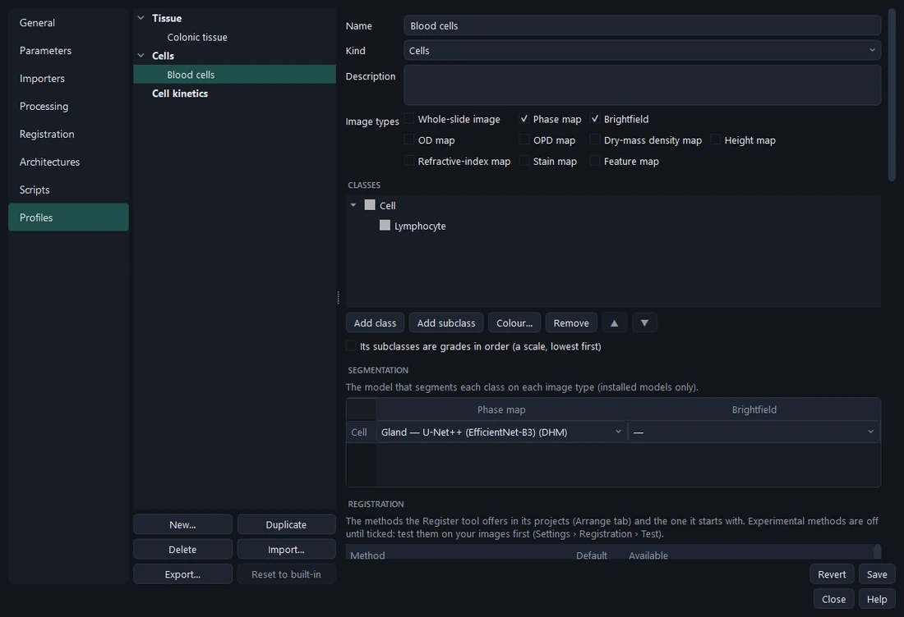
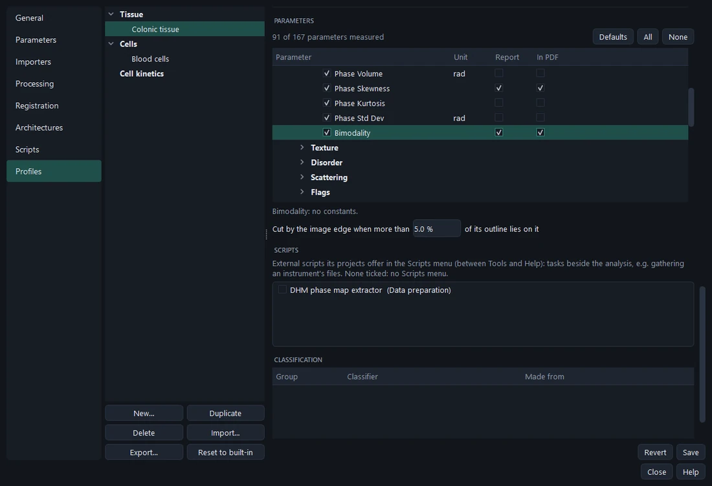

# Profiles

A **profile** is everything one kind of analysis needs. The people analysing pick it on the start screen; every
project made from it keeps its **own copy**, so a project always reopens with exactly the analysis it was made with,
whatever happens to the profile later.

**Settings › Profiles** creates, edits, duplicates, deletes, imports and exports them. *Colonic tissue* ships with
Modalytics, with gland models for DHM phase maps (U-Net, EfficientNet-B0) and H&E whole slides (U-Net++,
EfficientNet-B3) and the *ranges* rule that grades glands as low- or high-grade dysplasia from their bimodality and
phase skewness (validated on DHM phase maps of colonic polyps); nothing is locked — the shipped profiles are edited like any other, and **Reset to built-in** restores
them.

## What a profile holds

| Section | What it sets |
| --- | --- |
| **Name, kind, description** | The kind (*Tissue*, *Cells*, *Cell kinetics*) is where the start screen lists it. |
| **Image types** | Which images its projects accept: whole-slide, phase map, brightfield, and maps made by another program. |
| **Classes** | Groups and their subgroups, with colours; whether the subgroups are **grades in order** (▲ ▼) or unordered **categories**; aliases for older names. |
| **Segmentation** | The model per group and image type that *Segment* uses by default. |
| **Registration** | Which registration methods its projects offer, and the default. |
| **Processing at import** | Chains applied to each image type when imported (e.g. every slide's *OD map*). |
| **Processing steps** | The Process tab's buttons (**Toolbar**) and what else is offered (**Available**). |
| **Parameters** | What is measured, the constants of each, which are the report's **key parameters** and which go **In PDF**; when an object counts as cut by the image edge. |
| **Scripts** | The external scripts its projects offer in the Scripts menu. |
| **Classification** | The classifier per group (made in Training) and its **minimum confidence**. |

Edits apply to a working copy: **Save** writes it to your library, **Revert** drops them. Projects already made are
not affected.

## Classes: groups, grades and categories

A **group** is what is outlined (*Gland*) — what segmentation models find. Its **subgroups** are what each object is
graded as (*Low grade dysplasia*, *High grade dysplasia*) — what classifiers decide.

- **Grades in order** — a scale, lowest first (normal < low grade < high grade dysplasia). Statistics use trend
  tests, and the scale-climbing classifiers (Ranges, Score) are available.
- **Categories** — no order (four pathologies of one tissue). Statistics compare each class against the others and
  every pair; the learned classifiers (logistic regression, random forest, gradient boosting) grade them.

**Aliases** keep older annotations usable: *Colonic tissue* reads HoloPath's *Normal* and *Dysplasia low grade* as
*Low grade dysplasia*, *Dysplasia high grade* as *High grade dysplasia* — when a project or `.hpro` is opened and in
training sets.

## Parameters in the profile

- Tick what is measured (**Defaults**, **All**, **None** help). Only *Any image* and the profile's image types are
  listed.
- Select a parameter to set its **constants** for this profile (within the range its script allows) — e.g. the
  refractive index, the GLCM distance.
- **Report** — the key parameters: summarised per class and plotted in the report. Keep them few and meaningful.
- **In PDF** — the PDF summary's columns (paper cannot scroll: at most six are shown). None ticked: the classifier's
  parameters, then the key parameters.
- **Cut by the image edge when more than … % of its outline lies on it** — an object grazing the border keeps nearly
  all its shape; above this share it counts as partial.

## Classification in the profile

**Training › Classifiers › Build › Save to profile** puts a classifier here, with where it comes from (training set,
date, its evaluation). The profile lists it per group, can remove it, and sets the **Minimum confidence** (0.80 by
default) from which a classifier giving a probability grades a suggestion; below it the object is suggested
ungraded. The Segment tool shows and changes the same value.

## Sharing a profile

**Export…** writes one `.mprofile` file with everything the profile needs on another computer:

- its segmentation models — with their training weights, so others can fine-tune them, or without (about half the
  size); asked;
- its classifiers, the parameters it measures, the processing steps its chains use and the importers for its image
  types — those that are not built in;
- the libraries their scripts need (name and version), and the Modalytics version that made it.

**Import…** first says what it would do: what is new, what is already here (identical, reused), what differs from
yours (added as `…_2` — yours are never overwritten), what is missing, and which libraries need installing. The
profile is added as a new one, or replaces one of the same name when you choose (e.g. a newer release; projects keep
their own copy).

> **Caution** A model trained from restricted starting weights carries their licence. Exporting such a profile
> warns about it.
