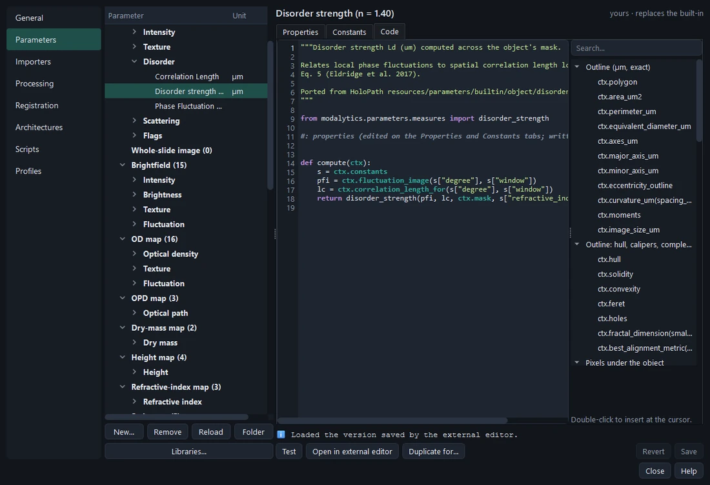
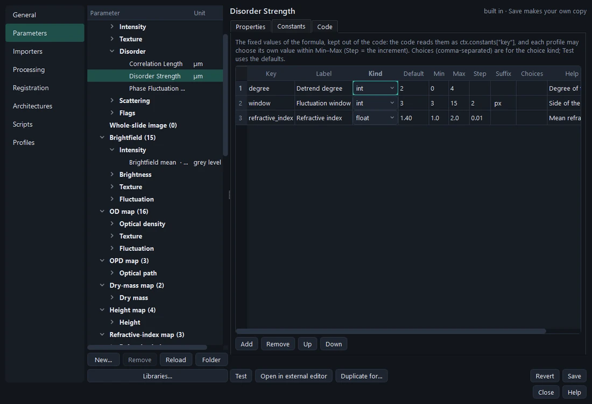
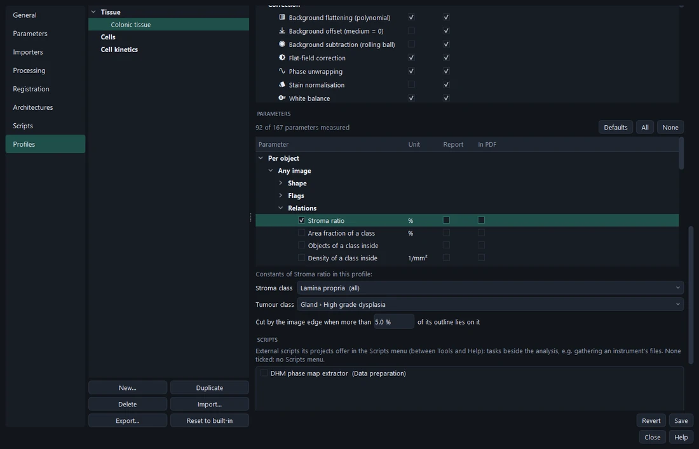
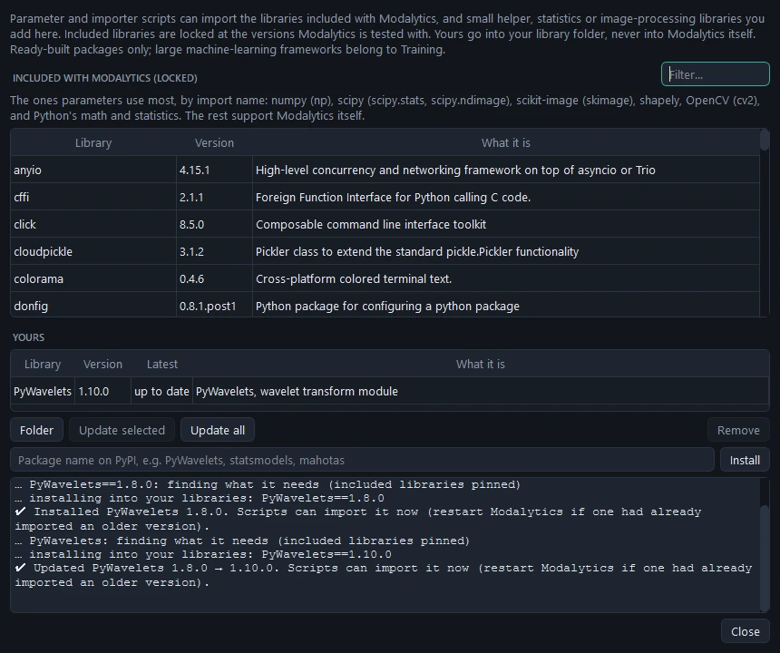

# Parameters

A **parameter** is one measurement, written as one small Python file: its description, unit, category, scope, image
type, references, constants, and a `compute(ctx)` function. **Settings › Parameters** lists and edits them.
HoloPath's parameter scripts run unchanged.

## The library

Parameters are listed as **Per object / Whole image / Per class › image type › category › parameter**.

- **Scope** — *per object* (each gland), *whole image*, or *per class in an image* (counts, densities, Awan's gland
  grading summaries).
- **Image type** — each parameter measures one type, since units and meaning differ (a phase map's mean is in rad, a
  brightfield mean in grey levels). *Any image* is for those that use only the outline (shape). **Duplicate for…**
  copies a parameter to another image type with its own unit.
- Its id is `<scope>:<image type>:<key>`, e.g. `object:phase:mean`.

More than 160 come built in: shape from the vector outline (area, perimeter, Feret diameters, solidity, fractal
dimension, Awan's best alignment metric…), intensity and texture (GLCM) on phase maps, OD maps and brightfield, phase
disorder, light scattering from the phase, dry mass, stain measures, and **relations between classes** (stroma
around a gland, nuclei inside a cell, distance to the nearest object of a class).

Every built-in parameter's **description says what it measures, with its formula**, and how to read it; those
defined in a publication list it under *References*, each checked against PubMed or Crossref. The description shows as
a tooltip in Results and in reports.

## Editing a parameter



- **Properties** — name, id, scope, image type, category, unit, description, references, *on by default*, **needs
  the whole object** (shape, totals and what follows the outline are left empty on partial objects; pixel statistics
  and texture measure the visible part).
- **Constants** — the fixed values of the formula, one row each (key, label, kind, default, range, suffix, help).
  The code reads `ctx.constants["key"]`; each profile chooses its own value within the range.
- **Code** — a small editor with highlighting, next to a searchable list of everything `ctx` offers; a double-click
  inserts it. **Test** (<kbd>Ctrl</kbd>+<kbd>T</kbd>) runs the edited code on a sample object and shows the value,
  or the error with its line. An external editor can be used alongside; changes on disk are picked up.



## Writing your own

**New…** starts from a commented template. The essentials:

```python
import numpy as np

KEY = "mean"
LABEL = "Phase Mean"
UNIT = "rad"
CATEGORY = "intensity"
SCOPE = "object"                 # "object", "image" or "class"
IMAGE_TYPE = "phase"             # "any", "phase", "wsi", "brightfield", "od", …
DEFAULT_ON = True
WHOLE_OBJECT = False             # True: left empty on partial objects
DESCRIPTION = "Mean x̄ = (1/N)·Σ xᵢ over the N pixels inside the object. …"


def compute(ctx):
    return np.mean(ctx.pixels)
```

What `ctx` offers (the helper list in the editor has them all, with examples):

- the outline (`ctx.polygon`, in µm) and its measures (`ctx.area_um2`, `ctx.perimeter_um`, `ctx.feret`…),
  the pixels inside it (`ctx.pixels`; `ctx.mask` and `ctx.image_crop` around it), the constants
  (`ctx.constants`);
- `ctx.surroundings(20)` — the band 20 µm around the object;
- `ctx.on("wsi")` — the same object on another, registered image of the project;
- **relations**: `ctx.other("Lamina propria")`, `ctx.inside(c)`, `ctx.area_of(c)`, `ctx.nearest(c)`,
  `ctx.surroundings(20, only="Lamina propria")`. The classes are **constants of kind "label"**, chosen in the profile
  from its own classes, so one script serves any class names.



> **Tip** Write the formula in the description. Whoever reads a report later sees it on hover, and it is the
> easiest place to check the code against the intent.

## Libraries

Scripts can import the libraries included with Modalytics (numpy, scipy, scikit-image, shapely, OpenCV…), locked at
the versions Modalytics is tested with, and small libraries you add: **Libraries…** (Settings › Parameters or
Importers) installs them into your library folder — never into Modalytics itself; ready-built packages only, nothing
that would change an included library.



A parameter declares what it needs (`REQUIRES = ["PyWavelets"]`, the *Requires* field); where it is missing,
Modalytics says so and offers to install it. An exported profile lists the libraries its scripts need.
