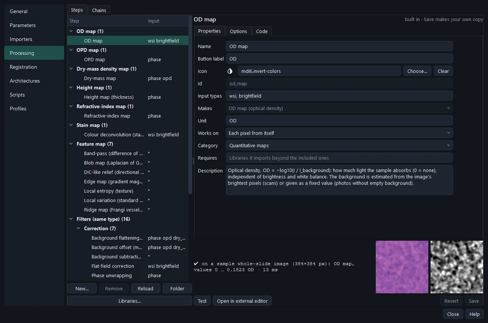
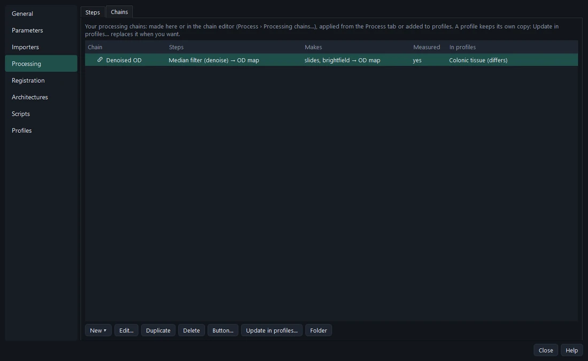
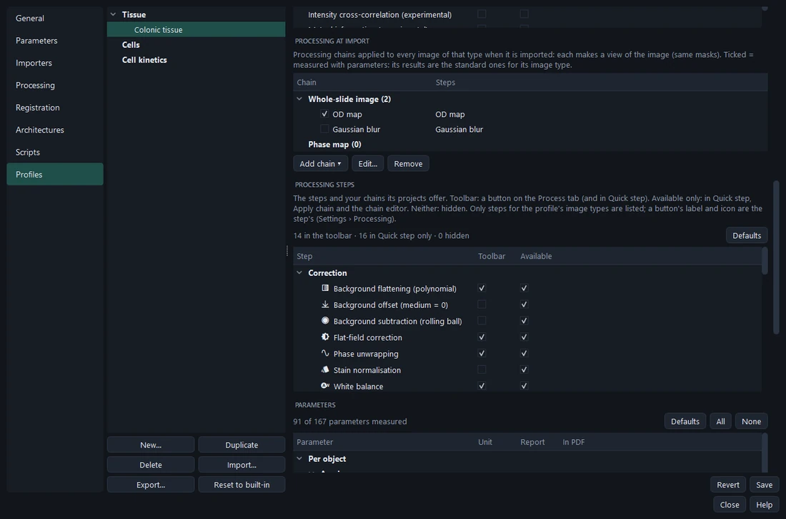
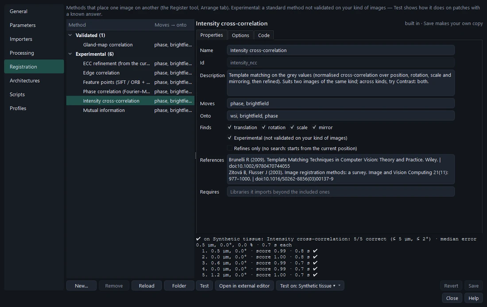

# Processing

A **processing step** makes a new version of an image: another image type (a slide's **OD map** or **stain map**, a
phase map's **OPD**, **dry-mass**, **height** or **refractive-index map**, a **feature map**) or the same type
corrected, denoised or enhanced. Steps are combined in **chains**; a chain applied to an image makes a **view** of it
— same pixel grid, place and masks — computed tile by tile, so even a whole slide's OD map costs nothing until it is
looked at or measured. Only the recipe is saved with the project.

## Built-in steps

| Category | Steps |
| --- | --- |
| Quantitative maps | **OD map** (slides, brightfield) · **Colour deconvolution** → stain map (H&E, H-DAB, H&E + DAB; standard or estimated vectors) · **OPD map** · **Dry-mass map** · **Height map** · **Refractive-index map** |
| Feature maps | Edge map · DIC-like relief · Blob map · Band-pass · Ridge map · Local variation · Local entropy |
| Correction | Background flattening · Background offset · Phase unwrapping · Flat-field correction · White balance · Stain normalisation · Rolling-ball background subtraction |
| Denoise | Gaussian blur · Median filter · Bilateral filter · Non-local means · Total-variation denoising |
| Enhance | CLAHE · Unsharp mask · Brightness, contrast and gamma · Colour → grey |

Each step's description in Settings gives what it computes and its references.

## Settings › Processing

**Steps** edits step scripts with the same editor as parameters; **Test** applies the step as edited to a sample
image and shows before / after. A step's **Button label** and **Icon** (Material Design Icons, chosen with
**Choose…**) are how the Process tab shows it.



**Chains** is your chain library: each chain's steps, what it makes (*slides, brightfield → OD map*), whether it is
measured, which profiles hold a chain of that name; **New**, **Edit** (the chain editor on a sample image),
**Duplicate**, **Delete**, **Button…**.



## Processing in a profile

- **Processing at import** — chains applied to each image type when it is imported. *Colonic tissue* gives every
  slide its *OD map*, so slides are measured through it (shape stays on the outline). A profile chain of the image's
  own type (e.g. a phase denoising) stands for the original, which then starts left out of the measurements.
- **Processing steps** — for each step and chain that fits the profile's image types: **Toolbar** (a button in the
  Process tab, and in Quick step) or **Available** (Quick step, Apply chain and the chain editor only); neither
  hides it. *Defaults* goes back to the default buttons.



A profile keeps its **own copy** of each chain: editing the chain in your library changes nothing by itself; **Update
in profiles…** replaces the copies you pick, and the Chains tab marks older copies "(differs)". Likewise a project
keeps its copy of the profile, and a view the exact chain it was made with — results never change behind your back.

## Which version is measured

- Parameters of an image type are measured on **every included version** (**Σ** ticked in *Layers › Processed*) of
  that type. The plain results come from the profile's chain of that type, else the original, else the first included
  view; every other included version adds its own columns, labelled with its name (*Mean phase · Denoised*).
- What the people analysing apply by hand starts **left out** when it is a filter of the same type or a quick step —
  only for looking.
- Training classifiers and grading suggestions read only the plain results.

## Writing a step

One `.py` file (`processing/<what it makes>/<key>.py` in your library):

```python
KEY = "od_map";  NAME = "OD map";  INPUT_TYPES = ["wsi", "brightfield"];  OUTPUT_TYPE = "od"   # "same" = a filter
UNIT = "OD";  KIND = "pixel"          # "pixel", "neighbourhood" (with margin()), or "whole" (small images only)
CATEGORY = "Quantitative maps"        # Quantitative maps, Feature maps, Correction, Denoise, Enhance
OPTIONS = [...]                       # float, int, choice, bool, file

def prepare(image, options) -> dict                     # optional: once per image (a background level…)
def process(pixels, options, state, um_per_px)          # a tile in → the same size out
```

Anything that depends on the whole image (a background level, a fitted surface, stain vectors) is computed once in
`prepare` from an overview, so every tile and zoom level is treated alike. A *neighbourhood* step declares the margin
it needs, so a chain computed tile by tile equals the same steps done on the whole image.

## Registration methods

Registration methods are scripts too (**Settings › Registration**): each declares what it can move and onto what,
what it finds (shift, rotation, scale, mirroring), its options and references, and a `register(ctx, options)` that
returns candidates. The Register tool gives every method the same search (rough position, radius, rotations, scales,
mirroring, number of candidates).



- **Gland-map correlation** (the default) — both images turned into gland-probability maps by their segmentation
  models, then searched by masked normalised cross-correlation and polished with ECC. Independent of the modality, so
  it works between a phase map and a stained slide; on known answers 1–7 µm from the truth.
- *Experimental* (standard methods, not validated on phase map ↔ slide): intensity cross-correlation, edge
  correlation, mutual information, phase correlation (Fourier–Mellin), feature points (SIFT / ORB + RANSAC), ECC
  refinement.

**Test** cuts patches from a reference (synthetic tissue, or a slide or image of yours) at known positions,
rotations and mirroring, and reports how far each method lands from the truth (µm, degrees, %) — judge a method on
your own images before trusting it. **Settings › Profiles › Registration** chooses which methods the profile's
projects offer and the default.
