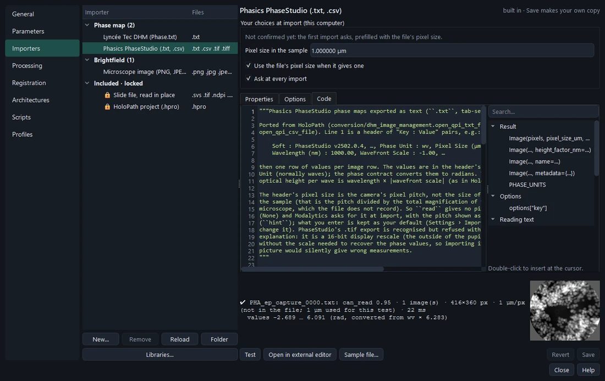
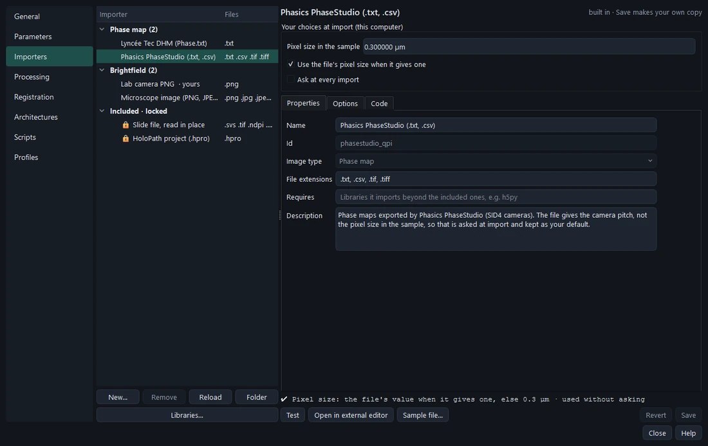

# Importers

Every instrument writes its own files, so reading them is modular: one Python script per file format, built-in ones
for the supported instruments and your own in your library. **Settings › Importers** lists and edits them.

## The contract

What an image must be once imported is fixed by Modalytics per image type — the **contract**. An importer only reads
its format and hands back the values; Modalytics converts and checks them.

| Image type | Contract | Built-in importers |
| --- | --- | --- |
| Phase map | 2D values in **radians**, pixel size in µm. The importer says which unit it read (rad, mrad, deg, waves); Modalytics converts. | Lyncée Tec DHM `Phase.txt`; Phasics PhaseStudio `.txt` / `.csv` |
| Brightfield | 8- or 16-bit grey or RGB | PNG, JPEG, BMP, TIFF (pixel size from ImageJ, OME or resolution tags) |
| Maps (OD, stain, OPD, dry mass, height, refractive index, feature) | one value per pixel in the type's unit, within its range | none: usually made by processing; your own importer brings in maps another program computed |
| Whole-slide image | tiled pyramid | **locked**: Modalytics' own readers (SVS, pyramidal TIFF / OME-TIFF, NDPI, SCN), read in place |

The imported image records where it came from — *Values in rad, converted from wv × 6.283 · pixel size entered at
import · read by Phasics PhaseStudio* in Properties.

## Writing an importer

**New…** offers a template.

```python
KEY = "my_format";  NAME = "My instrument (.dat)";  IMAGE_TYPE = "phase";  EXTENSIONS = [".dat"]
OPTIONS = []                 # values to ask at import, if the format needs any (e.g. a channel)

def can_read(path):          # 0–1: how sure it is this file is its format (the surest importer wins)
def hint(path):              # optional: what the file says that helps (shown where the pixel size is asked)
def read(path, options):     # → Image(values, pixel_size_um or None, unit="wv", metadata={…})
```

- Return the pixel size the file states, or `None` — never a guess. Modalytics asks for it when it is missing.
- **Test** reads a sample file and shows how sure `can_read` is, the size, the pixel size, the value range in the
  contract's unit and a preview — or the error with its line.



## Your choices at import

The first import with each importer asks for the pixel size once for all its files; with *Keep this and don't ask
again* later imports use the file's value, or yours. **Your choices at import** (Settings › Importers) shows and
changes them: a new pixel size after changing objective, whether the file's own value comes first, or asking again.



An exported profile carries your importers for its image types. Importers may use the same libraries as parameters
(`REQUIRES`).
