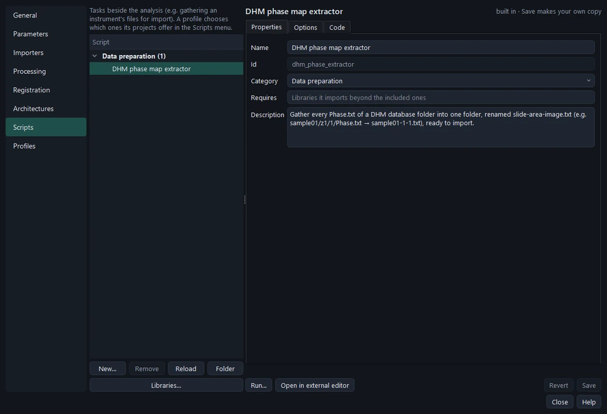
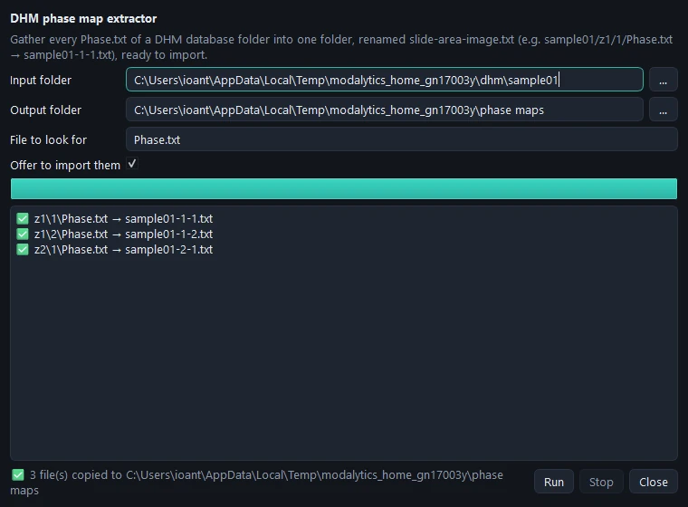

# External scripts

Tasks beside the analysis — preparing files, converting, collecting — are **external scripts**. The built-in **DHM
phase map extractor** walks a DHM database folder, takes every `Phase.txt`, names it after its slide, area and image
(`sample01/z1/1/Phase.txt` → `sample01-1-1.txt`), copies them into one folder, and offers to import them into the open
project.

## Settings › Scripts

Lists, edits, adds and removes them, with the same editor as parameters. A script is one `.py` file with its options
(folders, files, text, numbers, choices) and a `run(options, ctx)` function — no window code: Modalytics asks the
options, runs it in the background with a progress bar, a log and *Stop*, and imports the files it hands over
(`ctx.import_files`). **Run…** runs a script as edited; the values used last are offered again.

## In a profile

**Settings › Profiles › Scripts** chooses which scripts the profile's projects offer: they appear in a **Scripts**
menu between Tools and Help. With none ticked there is no Scripts menu. Your scripts travel in the profile's
`.mprofile`.

