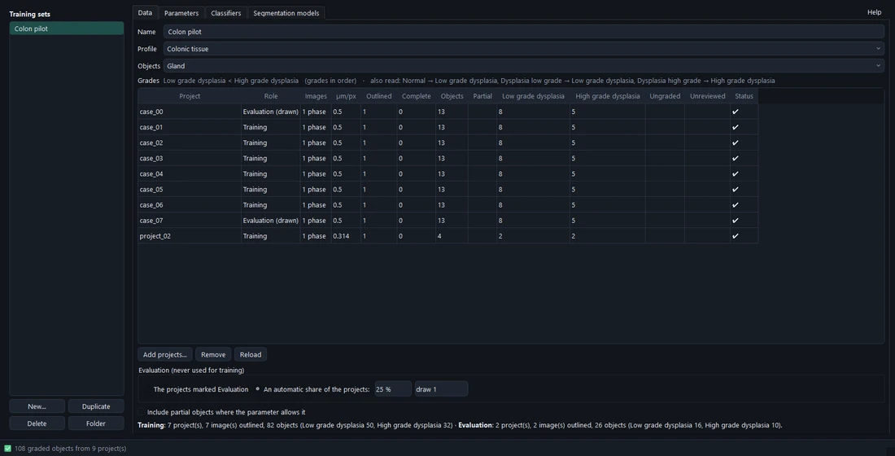

# Training sets

**Training** (start screen, or *File › Training…*) learns from projects whose objects were outlined and graded by
hand. It works on **training sets** — saved in your library (`training/*.mtrain`) — in tabs: **Data** (shared),
**Parameters**, **Classifiers** (Explore, Build) and **Segmentation models** (Evaluate, Train). <kbd>F1</kbd> opens
the help on the tab shown.

## The Data tab



A training set is:

- a **profile** — its object parameters are measured, its subgroups are the grades, in its order;
- the **objects** it is about — a class group (*Gland*): classifiers grade its subgroups, segmentation models outline
  it;
- the **projects** (`.modalytics`, or HoloPath `.hpro`) — **Add projects…**, **Remove** — each with its **role**.

The table says what each project holds, read in the background from its masks (nothing measured yet): images per
type and their **µm/px**, images outlined and marked complete, **objects**, **partial** ones, per grade, ungraded,
unreviewed suggestions, and any problem. Under it, per role, the projects, images and objects. A µm/px a power of ten
away from what most images have is flagged (⚠) — a decimal slip? **Reload** reads the projects again after they were
changed elsewhere. Every table in Training sorts by a click on a column title.

## Roles: training, evaluation, test

A project is always used **whole** — one sample is never split between roles: objects of one sample resemble each
other, and seeing some of them in training would make the evaluation look better than it is.

| Role | Used for |
| --- | --- |
| **Training** | Learning: choosing parameters, fitting classifiers, training models, cross-validation. |
| **Evaluation** | Judging during the work: comparing classifiers, choosing a model's best epoch. Never trained on. |
| **Test** | The final numbers only — never trained on, never used to choose anything. |

**Evaluation** — the projects you mark *Evaluation*, or **an automatic share** of them (a repeatable draw: the same
*draw* number gives the same projects; the draw keeps every grade on both sides).

**Test groups** — *New test group…* in the role box puts test projects in named groups, e.g. *Naive*, *External –
Hospital B*, *Setup 20×*. Each group is a final check of its own, most telling when it differs on purpose (another
microscope setup, another lab): it shows how far a classifier or model carries over. Classifier reports and
segmentation evaluations judge each group apart.

> **Tip** Decide the test projects **before** looking at any result, and do not move projects between roles after
> seeing the numbers — otherwise the test is no longer a test.

## Measuring

**Measure** (in the Parameters tab) gathers every graded object with the profile's parameters, in the background —
cached per project and profile, so reopening is quick; done by itself when projects are added. Parameters, Explore and
Build all read it.

**Partial objects** (shape incomplete) are measured but left out, unless **Include partial objects where the
parameter allows it** is ticked: they then count for the parameters that do not need the whole object (pixel
statistics, texture). A classifier uses them only when it reads none of the whole-object parameters.

A group with fewer than two subgroups has no grades: segmentation models can be trained on it, classifiers cannot.

## Where the runs are kept

Every analysis, classifier report, evaluation and training run has a folder under its training set, the date and
time first so they sort by date:

```
training_runs/
  Colonic Glands/
    parameters/      2026-10-25 01-14 Phase parameters/    report, results
    classifiers/     …                                     report, results
    segmentation/    …/models/…                            report, results, trained models
```

Each report has, beside *Open report*, **PDF** (A4 across, for its wide tables) and **XLSX…** (every table and
native, editable charts in an Excel workbook).
