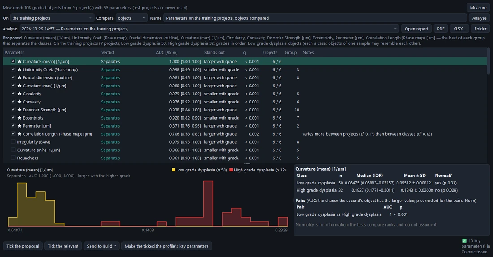

# Choosing parameters

**Training › Parameters** asks which of the profile's parameters carry information about the classes — before any
classifier is built.

## On which projects

- **The training projects** (the default) — for choosing: the evaluation and test projects stay untouched.
- **The training and evaluation projects** — to describe the data. Sending such an analysis to Build warns first:
  choosing on the evaluation projects flatters the classifier.

## What a case is: Compare

- **Objects** (the default) — each object a case: "do the classes differ in this material?" Objects of one sample
  resemble each other, so the p-values describe this material and may be optimistic about new samples (the report
  says so).
- **Images** — each image's class one case, the median of its objects; for projects holding several samples.
- **Projects** — each project's class one case: "will it hold for new samples?" The conservative choice, needing
  many projects per class.

## What Analyse gives

For every parameter, in the background:

| Result | Meaning |
| --- | --- |
| **AUC** with its 95 % interval | *Grades*: of two cases of different grades, the probability that the higher-grade one has the larger value (0.5 = no relation, 1 or 0 = perfect). *Categories*: the class that stands out against all others. Interval by bootstrap of the cases. |
| **p** and **q** | A permutation test (trend across grades; for categories, does any class differ), and q corrected for testing many parameters (Benjamini–Hochberg). |
| **Pairs** | Every pair of classes, its AUC and p (Holm-corrected). |
| **Per class** | Median (IQR), mean ± SD, and a normality test for information (the tests compare ranks and do not assume it). |
| **Verdict** | *separates* (q < 0.05 and AUC ≥ 0.7), *weak* (real but small), *not distinguishable from chance*, *promising, not confirmed* (too few cases to confirm), or *too few*. How many projects it goes the same way in, and a note when it varies more between projects than between classes (it may follow the acquisition). |
| **Group** | Parameters whose values follow each other (\|Spearman ρ\| ≥ 0.8) measure one thing. |

## From the analysis to Build

- **Tick the proposal** — the best parameter of each group that separates (★).
- **Tick the relevant** — the best of each group that separates *or weakly does* (a wider set, e.g. for the learned
  classifiers).
- **Send to Build ▾** — makes **Ranges**, **Score**, **Logistic regression**, **Random forest**, **Gradient boosting**,
  or all of them from the ticked parameters, and shows Build.
- **Make the ticked the profile's key parameters** — they are put forward in the projects' reports.

Each analysis is kept with its **report** (the table, per class, the pairs, the AUCs with their intervals, each
separating parameter's values per class, the groups, methods); *Open report*, **PDF**, **XLSX…**.

> **Caution** With few projects, fewer parameters do better. Two or three that separate, from different groups, are
> usually more honest than ten: every extra parameter is one more chance to fit the noise of these projects. See
> [Good practice](10-good-practice.md).
