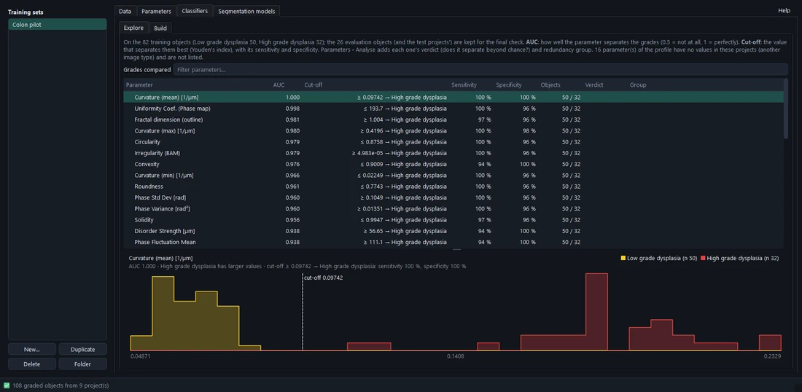
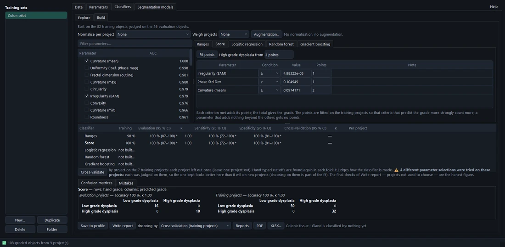
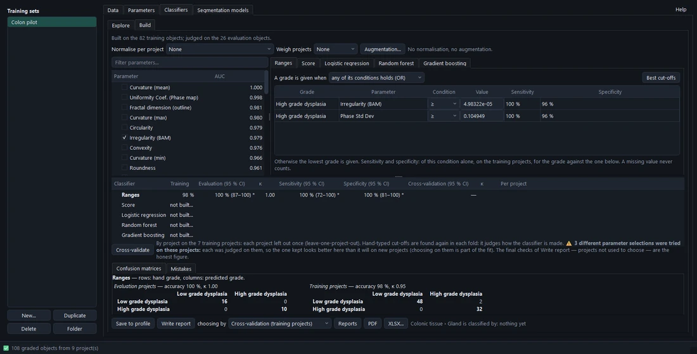
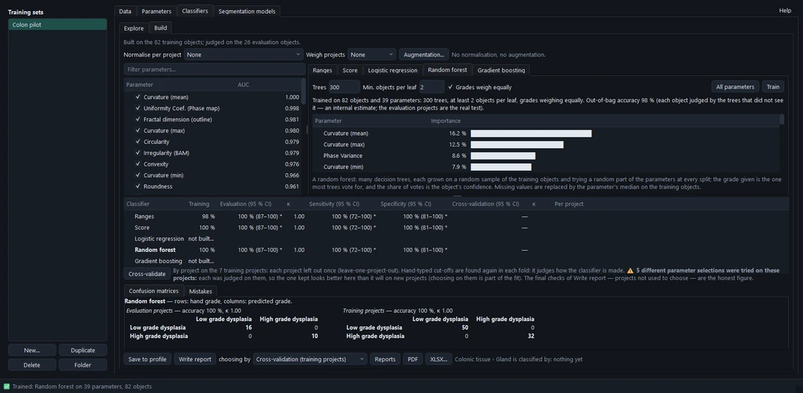
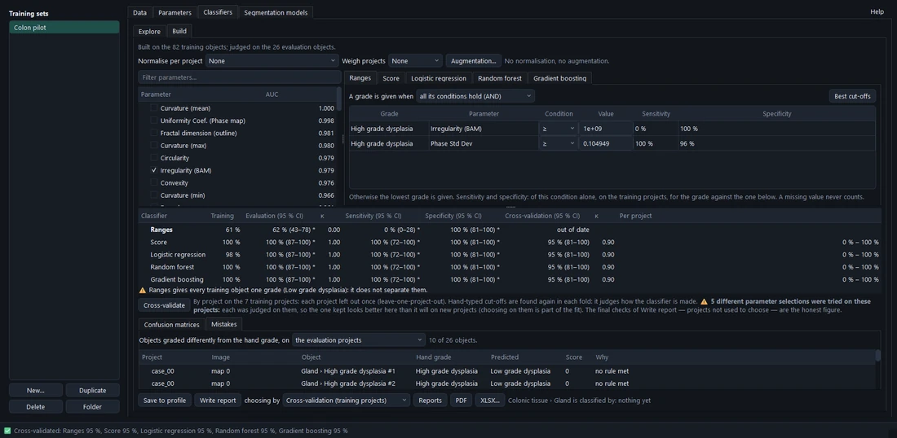

# Classifiers

A **classifier** grades objects from their parameters. It is made in **Training › Classifiers**, judged honestly,
and saved to the profile, where Measure, Segment and *Classify selected* use it.

## Explore

The range finder, on the **training projects** only: every parameter ranked by how well it separates two grades —
**AUC** (0.5 = not at all, 1 = perfectly) — with the cut-off that separates them best (**Youden's index**: the largest
sensitivity + specificity − 1) and its sensitivity and specificity. A click shows the parameter's distribution per
grade with the cut-off. Each parameter's verdict and group come from the analysis in Parameters.

## Build

Classifiers from the parameters you tick, fitted on the training projects. Five kinds, side by side:

| Kind | How it grades | Readable? | Gives a probability? |
| --- | --- | --- | --- |
| **Ranges** | Each parameter a condition (≥ or ≤ a cut-off); a grade is given when **all** (AND) or **any** (OR) of its conditions hold, else the lowest grade. | yes | no |
| **Score** | Each parameter a criterion at a cut-off worth whole **points**; the total against a threshold per grade. | yes | no |
| **Logistic regression** | One weight per parameter (standardised), shown with its odds ratio per standard deviation. | yes | yes |
| **Random forest** | Many decision trees voting; each parameter's importance shown. | partly | yes |
| **Gradient boosting** | Shallow trees one after another, each correcting the last. | partly | yes |

- **Ranges** — the cut-offs are found **together** for the rule (each found alone is best for its parameter alone;
  with AND the rule would call far fewer objects the higher grade). **Best cut-offs** finds them again; typed values
  stay until the rule changes. A warning shows with AND over three or more conditions.
- **Score** — the points are fitted by logistic regression (scaled so the weakest counts 1, rounded), each grade's
  threshold is the total that separates best, and the cut-offs are then found together. **Fit points** fits again;
  everything is editable.
- **Logistic regression** — *Shrinkage* (L2) and *Grades weigh equally*; multinomial with more than two classes.
- **Random forest** — *Trees*, *Min. objects per leaf*, *Grades weigh equally*, **All parameters**; **Train** grows it
  in the background. Out-of-bag accuracy shown.
- **Gradient boosting** — *Trees*, *Depth*, *Learning rate*; **Train**.

Ranges and Score are for grades in order; the other three also grade categories. Forests and boosting are stored in the
profile as their trees' numbers (no code), and classifying gives exactly the probabilities they were trained with.

### How the objects are prepared

The same for every classifier, recorded with each and named in the report:

- **Normalise per project** — each parameter read relative to its project's complete objects (at least 5): the
  difference from or ratio to the project's median, or a robust z. It takes out what a whole project shares
  (illumination, calibration, thickness); a new project is read the same way when classified. Modalytics asks first
  when a third or more of the training projects hold one grade only — normalising takes that grade's difference out
  of them.
- **Weigh projects** (off by default) — each project's objects weigh together as much as any other project's
  (**Equal**), or ∝ √ its objects (a compromise). Use with care: one object of a one-object project then weighs as
  much as thirty of another.
- **Augmentation…** — more rows, from the training projects only: **acquisition copies** (each project measured
  again as if acquired a little differently — pixel size, gain, offset, noise, defocus), **noisy copies** of each
  object, and **SMOTE** (the smaller classes topped up). Classifiers are always judged on real objects.

## Validation

Under Build: each classifier's accuracy, **balanced accuracy**, Cohen's κ, sensitivity and specificity, with their 95 %
intervals, and the confusion matrices.

- With 5 or more projects the interval resamples **whole projects** (objects of one project are not independent).
  With fewer, Wilson's interval over the objects, marked **\*** — likely too narrow.
- **Cross-validate** judges the classifiers again by project on the training projects: each made again without one
  project (or one fold of projects) and grading it. Cut-offs are found again in each fold, so it judges **how the
  classifier is made**, not one set of numbers.
- **Warnings** under the table: a classifier that leaves training objects out (partial ones, when it reads a
  whole-object parameter), gives every object one grade, or was chosen after many parameter selections were tried on
  these projects.

## Mistakes

The objects graded differently from the hand grade — **on the evaluation projects**, or **on the training projects,
cross-validated** — with project, image, object, both grades, the score and the reason. A double-click opens the
project at that object: often the hand grade, or the outline, deserves a second look.

## The report

**Write report**, **choosing by** *Cross-validation* (the default: many projects decide) or *Evaluation projects*,
compares every classifier built: accuracy, balanced accuracy, κ, MCC, macro-F1, ROC AUC with intervals; per class
sensitivity, specificity, PPV, NPV, F1; the confusion matrices; and each against the best (the paired difference).

- The **recommended** one has the best balanced accuracy — unless a readable one (Ranges, Score, logistic
  regression) is not distinguishable from it, which is then preferred.
- **Final checks** — every group of projects that took no part in the choice (the evaluation projects when chosen by
  cross-validation, and each test group), side by side and one by one, after the choice and without changing it.
  These are the honest figures.

Reports are kept in `training_runs/<set>/classifiers/`; **Reports** opens the folder; **PDF** and **XLSX…** export.

## Save to profile

**Save to profile** makes the classifier shown the profile's classifier for the group, with where it comes from
(training set, date, evaluation). It asks whether to make a new classifier or replace the one there, and shows the
report's measures. *Settings › Profiles › Classification* lists it, removes it, and sets its **minimum confidence**.
Projects already made keep their copy; **Measure** offers the newer one.
