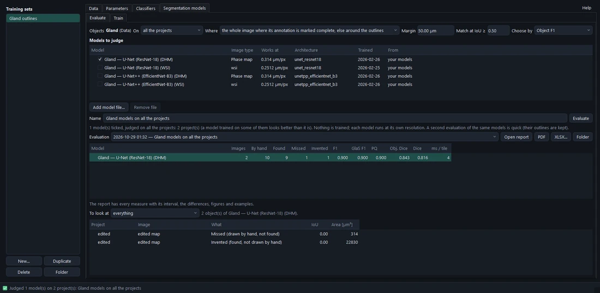
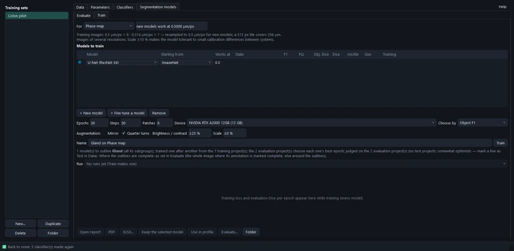
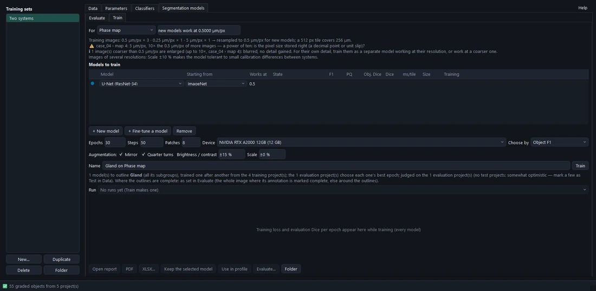
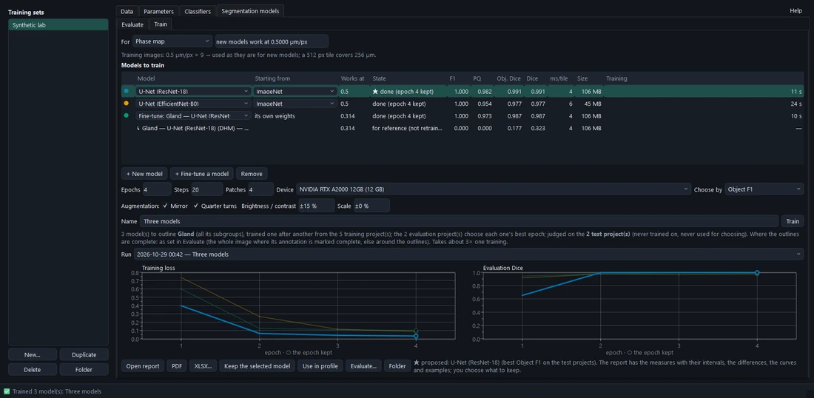
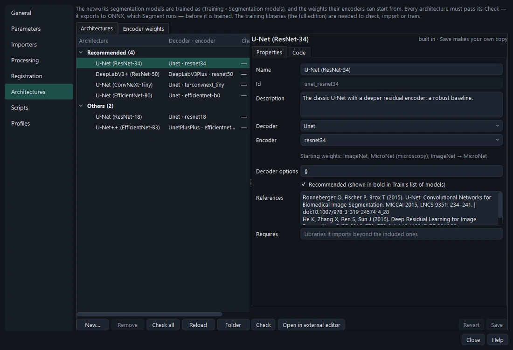
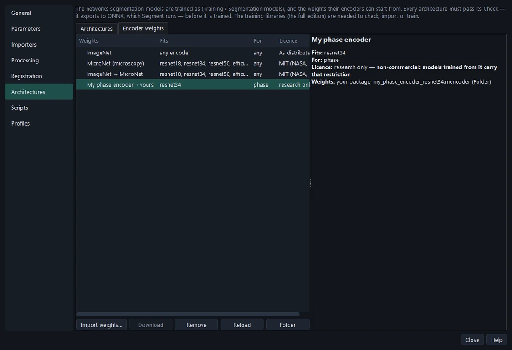

# Segmentation models

A **segmentation model** (`.mmodel`: an ONNX network and its manifest) finds the objects of one group on one image
type, at one resolution (µm/px). Models run on any graphics card (DirectML on Windows) or the CPU; PyTorch is needed
only to train them.

## Evaluate existing models

**Training › Segmentation models › Evaluate** judges and compares **existing** models — nothing is trained there:
models kept from a training run, released ones, or another person's file (**Add model file…**: used where it is, not
installed). Each runs at its own resolution on the images of its type.

1. Tick the models.
2. Choose the projects: **the test projects** (the fair comparison, the default when there are some; with several
   test groups, all or one), the evaluation projects, or all (warned: a model trained on some of them looks better
   than it is).
3. **Evaluate** — in the background, each model's outlines are compared with the hand outlines of the set's group,
   on the vector outlines themselves, in µm².

The results table: found / missed / invented objects, **F1**, **GlaS F1**, **PQ**, object Dice and Dice, the proposal
starred (the best by *Choose by*). Select a model to see the objects **to look at** — missed, invented, merged, split,
poorly outlined; a double-click opens the project there with the model's outline drawn.

**Where** the comparison is made: by default **per image** — the whole image where it is marked *Annotation
complete*, elsewhere only around the hand outlines (images outlined in places); or the whole image everywhere, or
around the outlines everywhere. Unreviewed suggestions are always left out.

### The measures

| Measure | Meaning |
| --- | --- |
| **Object F1** | A model object matches a hand object at IoU ≥ 0.5: found (TP), missed (FN), invented (FP); F1 = 2TP / (2TP + FP + FN). |
| **GlaS F1** | The GlaS challenge's more lenient rule (a model object covering ≥ 50 % of its hand object); the one to compare with published results. |
| **PQ** | Panoptic quality = the matched objects' mean IoU × F1: finding and outlining together. |
| **Object Dice** | GlaS object Dice: each object against the one overlapping it most, weighted by area. |
| **Dice** | Pixel overlap 2\|A∩B\| / (\|A\|+\|B\|), ignoring objects. |

Each comes with its 95 % interval (bootstrap over images); with several models, each is compared with the proposal —
*clearly better* or *not distinguishable* on these images.

## Train new models

**Training › Segmentation models › Train** trains **one or more** models on the training set in one run, compares
them, and keeps the one you choose.

### The training pack

Training needs PyTorch, which is large (up to 2.6 GB) and depends on the graphics card, so it is not part of the
program: the first time you open Train, it offers the **training pack** for this computer —

| Found | Pack | Download |
| --- | --- | --- |
| an NVIDIA graphics card | PyTorch for CUDA | about 2.6 GB |
| an Intel Arc graphics card | PyTorch for Intel GPUs | about 1.2 GB |
| anything else (AMD cards on Windows included) | PyTorch for the processor — training works, slowly | about 0.3 GB |

**Install the training pack** downloads it (the log shows the progress) and checks it — PyTorch is loaded and one
training step is made — before using it; Train is ready at once. The installer can also do this at the end of
setup (*Download training support now*). The pack is kept per user in `%LOCALAPPDATA%\Modalytics\training`, at
the versions Modalytics was tested with.

**When the hardware changes** — an NVIDIA card added to a computer that had none, say — Train says so and offers to
**switch** packs, with the download's size; the current pack keeps working until the new one has passed its check,
and the new one is used from the next start. **Keep the current one** leaves it as it is.

- **+ New model** — an architecture from the library, its encoder starting from **encoder weights** (ImageNet,
  MicroNet, yours) or random weights. **+ Fine-tune a model** — an installed model that carries its weights, trained
  further and judged **as it was** too, so you see whether fine-tuning helped. The recommended architectures are in
  bold.
- **Resolution** — a model works at one µm/px; each image is resampled to it, so images of several systems can be
  mixed. The tab proposes the most common and warns about images that would be enlarged (coarser than the working
  resolution: blurred, no detail gained).

  

- **Augmentation** — each training patch changed at random: **Mirror** and **Quarter turns** (on), **Brightness /
  contrast** (± 15 %), **Scale ±** (off; ± 10 % helps when images come from several systems).
- **Epochs**, **Steps**, **Patches**, **Device**, **Choose by** (object F1, PQ, object Dice or Dice).
- **Train** — the models one after another. Live: each row's state and the curves (training loss, evaluation Dice)
  side by side; after each epoch the evaluation projects choose the best epoch.

### The result

Each model is judged on the **test** projects (or, without any, on the evaluation projects — said plainly: somewhat
optimistic, since they chose the epochs), timed and sized. The best by *Choose by* is proposed; **you decide**.

- **Keep the selected model** installs it in your models (a run of one model keeps it by itself).
- **Use in profile** makes it the profile's model for the group and image type.
- **Evaluate…** judges it in Evaluate beside other existing models.
- **Open report** — data and training, the measures with intervals, each model against the proposal, learning curves,
  accuracy against speed, per project, example images with hand (green) and model (magenta) outlines, methods.

Every run is kept in `training_runs/<set>/segmentation/`; **Run** lists them, and picking an earlier one brings back
its models and results.

> **Note** PyTorch has no build for AMD graphics cards on Windows yet (only Linux, ROCm): on Windows, train on an
> NVIDIA card, or on the processor (slowly). The trained models then run on any card, AMD included.

## Architectures and encoder weights

**Settings › Architectures** holds what training draws from:

- **Architectures** — a decoder and an encoder of segmentation-models-pytorch, written without code
  (`DECODER = 'Unet'`, `ENCODER = 'resnet34'`), or a network of your own with `build(…)`. The encoder is picked from
  the ones the libraries know. **Check** proves the contract before anything is trained: built, exported to ONNX and
  run by ONNX Runtime, its output must match PyTorch's — Segment runs ONNX, so a network that exports differently
  would segment differently from how it trained.

  

- **Encoder weights** — the starting weights (data, never code): **ImageNet** (natural photographs), **MicroNet** and
  **ImageNet → MicroNet** (encoders trained on ~100,000 micrographs), and yours (**Import weights…**, checked to fit
  the encoder). Each states its licence and whether models trained from it may be shared freely.

  

| Architecture | Parameters | Tile (512 px) on a fast card |
| --- | --- | --- |
| U-Net (ResNet-18) | 14.3 M | 12 ms |
| U-Net++ (EfficientNet-B3) — the shipped whole-slide gland model | 13.6 M | 31 ms |
| **U-Net (ResNet-34)** — a robust baseline | 24.4 M | 17 ms |
| **DeepLabV3+ (ResNet-50)** — wide context | 26.7 M | 51 ms |
| **U-Net (ConvNeXt-Tiny)** — a modern encoder | 31.9 M | 31 ms |
| **U-Net (EfficientNet-B0)** — small and fast; the shipped DHM gland model | 6.3 M | 47 ms |
