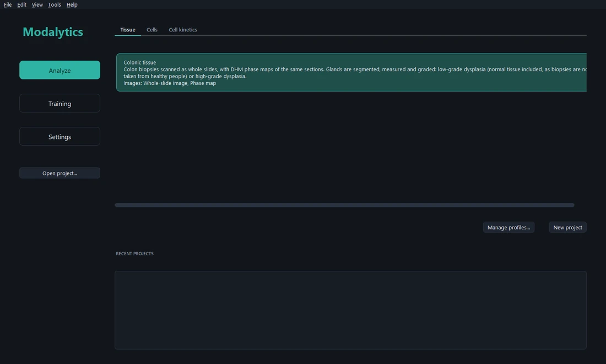
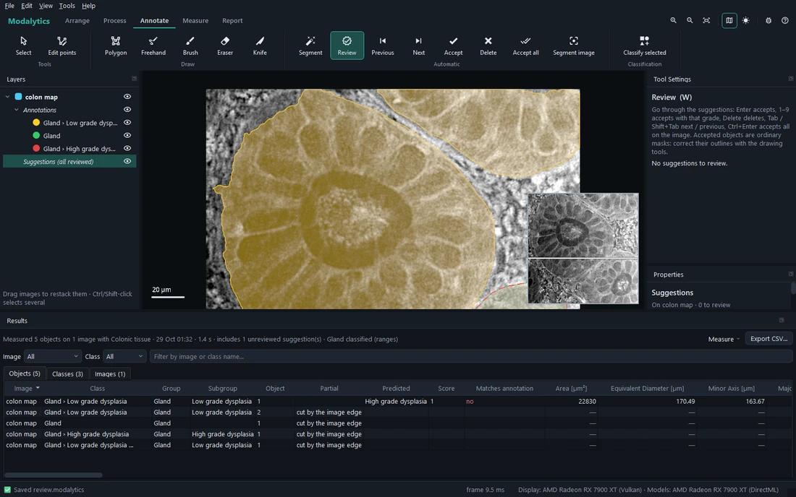

# Getting started

## The start screen

Modalytics opens on the **start screen**, with three ways in:

- **Analyze** — the profiles of each kind (*Tissue*, *Cells*, *Cell kinetics*). Pick one and **New project** starts
  an empty project with a copy of it; **Open project…** and the recent projects open an existing one.
- **Training** — teaching Modalytics from projects graded by hand (the power users' side: see *Profiles,
  parameters and training*).
- **Settings** — the libraries of parameters, importers, processing steps, scripts and profiles, and this computer's
  preferences.

*File › Start screen* comes back here at any time; *File › New project…* (<kbd>Ctrl</kbd>+<kbd>N</kbd>) too.

## A first project, step by step

1. On the start screen, choose the profile (e.g. **Colonic tissue**) and click **New project**.
2. **File › Import › Images…** (<kbd>Ctrl</kbd>+<kbd>I</kbd>) and pick the slide and the phase maps. The first time
   an importer is used it asks for the **pixel size** — confirm the value read from the file, or type it. Several
   images are **arranged** (a grid, by name…) — see [Projects and images](02-projects-and-images.md).
3. Outline the objects by hand ([Annotating](03-annotate.md)) or let a model find them: the **Segment** tool
   (<kbd>G</kbd>) on a region, or **Segment image** for the whole image.
4. **Review** (<kbd>W</kbd>) what the model suggested: <kbd>Enter</kbd> accepts, <kbd>1</kbd>–<kbd>9</kbd> accepts
   with a grade, <kbd>Delete</kbd> deletes ([Segmenting, reviewing and classifying](04-segment-review-classify.md)).
5. **Measure** (<kbd>Ctrl</kbd>+<kbd>M</kbd>): every object, class and image gets its parameters in the
   **Results** panel ([Measuring and results](05-measure-and-results.md)).
6. **Report…** writes the report; **PDF…** a printable summary ([Reports](06-reports.md)).
7. **File › Save** (<kbd>Ctrl</kbd>+<kbd>S</kbd>). The project is one file, `name.modalytics`.

## The window

- The **ribbon** (top) holds the tools and commands in tabs, in the order of the work: **Arrange**, **Process**,
  **Annotate**, **Measure**, **Report**. At its right end: zoom in and out, fit all, the **minimap**, the **theme**
  (the sun switches to light, the moon to dark), **Report a bug** and **Help**.
- **Layers** (left): the images — the top of the list is drawn on top — each with its annotations, suggestions and
  processed versions.
- The **canvas** (centre) shows everything at its true size in µm, with a scale bar and the minimap.
- **Tool Settings** (right) shows the active tool, how to use it and its settings; **Properties** under it shows
  what is selected — an image, a mask, an object, a suggestion.
- The **Results** panel (under the canvas) appears after measuring.
- The **status bar** (bottom) says what happened last, shows background tasks with their progress and *Cancel*, and,
  at the right, the graphics card drawing the canvas and the device the models run on.

Panels can be moved and floated (drag their title); the Results panel can be closed and is brought back with
**Results** (Measure tab, or *View › Results*).

## Undo

Every change — a stroke, an accepted suggestion, a moved image, a processing step — is **one undo step**:
<kbd>Ctrl</kbd>+<kbd>Z</kbd> undoes, <kbd>Ctrl</kbd>+<kbd>Y</kbd> redoes (also *Edit › Undo / Redo*, which name the
step).
