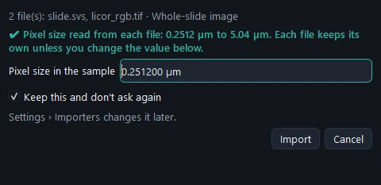
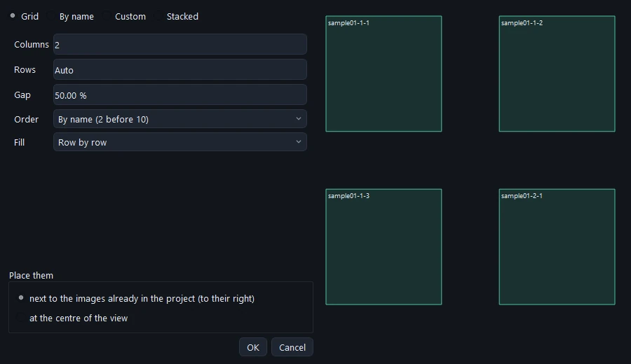
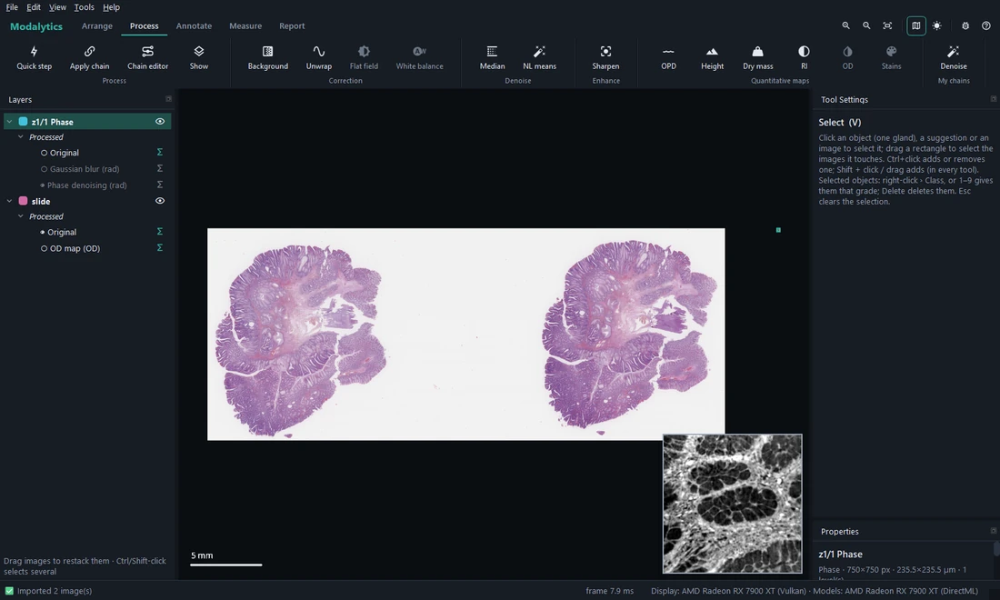
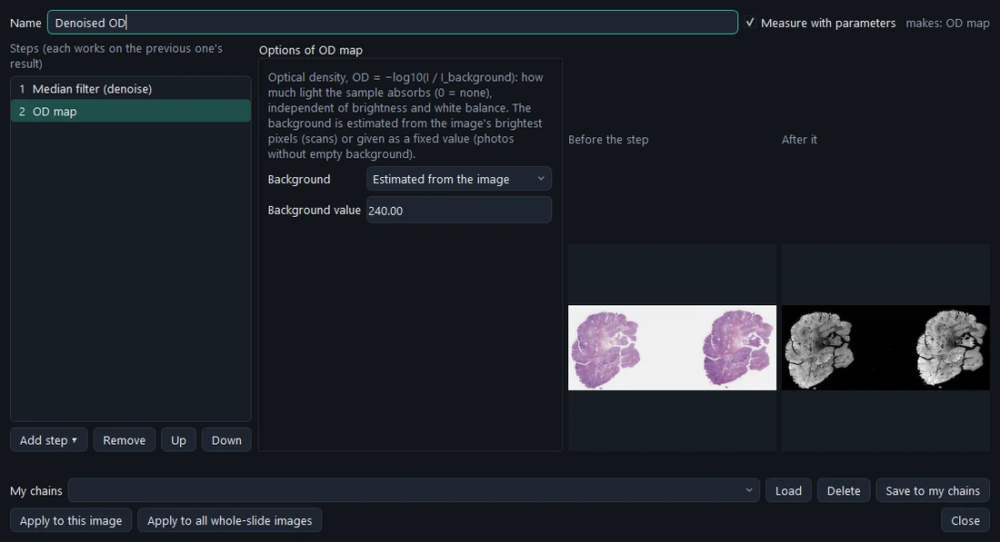
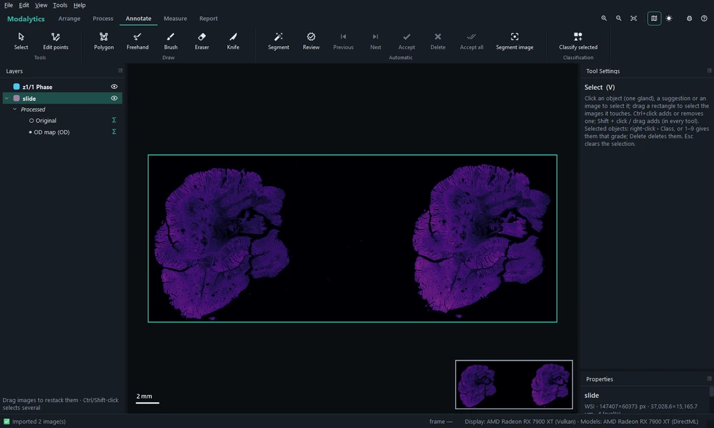
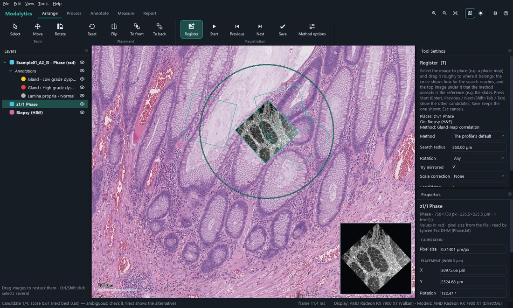
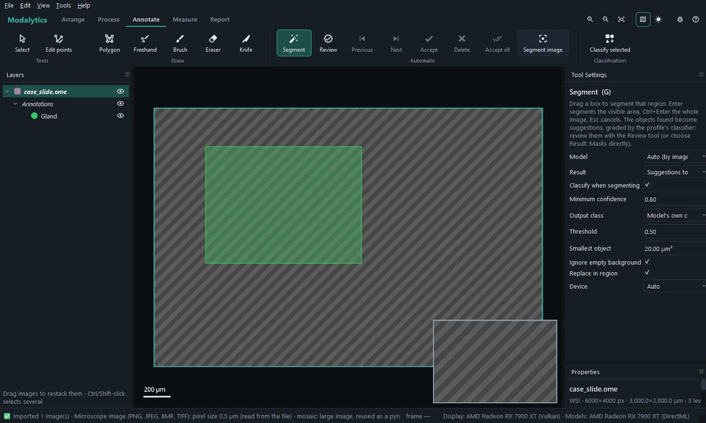

# Projects and images

## Importing images

**File › Import › Images…** (<kbd>Ctrl</kbd>+<kbd>I</kbd>) takes slides, phase maps and microscope pictures, several at
once. Each file goes to the **importer** most sure it can read it (you choose when two are equally sure); files
nothing recognises are listed. A project takes only the image types its profile accepts — the others are refused,
with the reason.

| Image type | Files read | Stored as |
| --- | --- | --- |
| Whole-slide image | Aperio SVS, pyramidal TIFF / OME-TIFF, Hamamatsu NDPI, Leica SCN | **read in place**: the project refers to the file, never copies or changes it |
| Phase map | Lyncée Tec DHM `Phase.txt`, Phasics PhaseStudio `.txt` / `.csv` | inside the project, in radians |
| Microscope image (brightfield) | PNG, JPEG, BMP, TIFF (8/16-bit, grey or colour) | inside the project |

Your profile may add importers for other instruments (see *Profiles, parameters and training › Importers*).

### The pixel size

Everything in Modalytics is measured in micrometres, so each image needs its **pixel size in the sample** (µm/px).
The first import with each importer asks for it once, for all its files:

- **✔ Pixel size read from the file** — the value the file states, prefilled: check it and confirm.
- **⚠ The file does not give the pixel size** — e.g. PhaseStudio files carry only the camera pitch, PNG and JPEG
  only a print resolution. Type it (from the microscope's calibration); what the file does say is shown as a hint.

With **Keep this and don't ask again** ticked, later imports use the file's value (or yours, when the file has none)
without asking; the status bar says which. *Settings › Importers › Your choices at import* changes it later — e.g.
after changing the objective.

> **Caution** A pixel size wrong by a factor of ten (3.14 typed for 0.314 µm/px) makes every object ten times too
> large and every area a hundred times. Modalytics warns where it can (Training compares the images' sizes), but
> checking the value at import is the surest.

### Very large images

Slide files that are tiled pyramids are read where they are — no conversion, no copy. A very large image that is
not a pyramid (a stitched mosaic saved as one plain file, over 64 megapixels) is converted once into a pyramidal
OME-TIFF next to it (`name.pyramid.ome.tif`), which later imports reuse. When a project would hold more than three
whole-slide images, or ten gigapixels in all, a notice says it may become slow: one or a few slides per project is
usually best.

## Arranging images

Importing several images asks how to **arrange** them, with a sketch to scale:

- **Grid** — columns and rows (*Auto* works one out from the other), the gap in % of the largest image, row by row or
  column by column, in name order (`…-2` before `…-10`).
- **By name** — row and column read from parts of the names: `sample01-1-2` → row 1 (area), column 2 (image), as the
  DHM phase map extractor names them.
- **Custom** — each image's row, place and the gap after it; or **Stacked**, all on one spot.
- Next to the images already in the project, or at the centre of the view.

Afterwards, the **Arrange** tab:

| Tool or command | What it does |
| --- | --- |
| **Move** (<kbd>M</kbd>) | Drag an image; its masks follow. <kbd>Ctrl</kbd> + middle drag moves an image with any tool. |
| **Rotate** (<kbd>R</kbd>) | Drag around an image to turn it about its centre; <kbd>Shift</kbd> snaps to 15°. |
| **Flip** | Mirrors the selected image left ↔ right in place (masks follow). |
| **Reset** | Puts the selected image back where it was imported. |
| **To front / To back** | Restacks the selected image. Dragging images up or down in Layers does the same. |
| **Register** (<kbd>T</kbd>) | Finds the exact position of a phase map on a slide — below. |

## Layers

Each image in **Layers** has its layers in folders:

- **Annotations** — the masks, one per class (the folder's eye shows or hides them all).
- **Suggestions** — what a model proposed, waiting for review, split by group (see
  [Segmenting, reviewing and classifying](04-segment-review-classify.md)).
- **Processed** — *Original* and its views (an OD map, a filter…): ◉ marks the one drawn, a click draws another,
  **Σ** says whether that version is measured.

The **eye** at the right of a row shows or hides it. <kbd>Ctrl</kbd> / <kbd>Shift</kbd>-click selects several layers,
and **right-click** acts on all of them: show, hide, frame in view, move to the top or bottom, process, segment,
remove. Right-click on a mask: *Transfer to…* another image, **Change class** (all its objects get another class —
e.g. an old project's "Normal" layer becoming "Low grade dysplasia"), *Delete*.

## Processing: making views

The **Process** tab makes **views** of the selected image(s): another version of the same pixels — an **OD map** of
a slide (optical density, what is absorbed), an **OPD** or **dry-mass map** of a phase map, a denoised or
background-flattened version. A view is not a new image: it keeps the image's place and masks, and is listed under
it in *Layers › Processed*.

- The profile's buttons (e.g. **OD**, **Dry mass**, **Background flattening**) apply one step at once; a button is
  enabled only when a selected image can take it.
- **Quick step** — every step the image can take, by category; **Apply chain** — one of the saved chains.
- **Chain editor** — several steps in a row, each with its options and a before / after preview, applied to this
  image or to all images of its type.
- **Show** — the original or a view; edit a view's chain, or remove it.

**Which version is measured.** The profile's own processing (e.g. every slide's *OD map*) is made at import and
measured. What you apply by hand starts **left out** of the measurements when it is a filter of the same type or a
quick step — only for looking — so nothing changes the numbers until you tick its **Σ** in Layers. Views are computed
tile by tile where they are looked at or measured, so even a whole slide's OD map costs nothing until it is used;
only their recipe is saved with the project.

## Registering a phase map onto a slide

A phase map carries no stage position, and glands repeat all over a slide, so Modalytics needs a **rough
position** first; it then finds the exact one. The phase map moves onto the slide — the slide never moves.

1. Select the phase map, choose **Register** (<kbd>T</kbd>) and drag the map roughly into place over the slide. The
   circle is the search radius.
2. **Start** (ribbon) or <kbd>Enter</kbd> searches within the circle — every rotation, optionally mirrored and with a
   small scale correction.
3. The best position is applied and the other candidates are outlined: **Previous / Next** (<kbd>Shift</kbd>+<kbd>Tab</kbd>
   / <kbd>Tab</kbd>) shows them. A clear gap to the next candidate is reported as a clear match.
4. **Save** keeps the one shown; <kbd>Esc</kbd> cancels.

Tool Settings: the **Method** (the profile's default, or another it allows), **Search radius**, **Rotation**, **Try
mirrored**, **Scale correction**, **Candidates**; *Method options* (ribbon) has the method's own settings. The
default method compares gland maps made by the segmentation models of both images, which makes it work between a
phase map and a stained slide.

## Saving and opening

- A project is **one file**, `name.modalytics`: its images (small ones inside, slides by reference), the masks as
  exact vector outlines in µm, the views as recipes, the results, the profile's copy. Saving writes a new file and
  swaps it in, so a crash never leaves a half-written project.
- **HoloPath projects** (`.hpro`) open through *File › Open* as a new, unsaved project, with their outlines and
  brush masks; *File › Import › HoloPath project* adds one to the open project.
- **A slide file not found** when a project opens (a disconnected drive, a moved folder) does not lose the image: it
  shows as a striped placeholder with its masks, and **Properties › Relink…** points it to the file where it is now
  (its size and fingerprint are checked). Reopening also warns when the file at that path is no longer the same one.

## Annotations from other programs

- *File › Import › Annotations…* merges GeoJSON (QuPath) or Leica / Aperio ImageScope XML outlines into the
  selected image (one undo step).
- *File › Export › Masks of the selected image as GeoJSON* writes them for QuPath: one feature per object, class
  "Group: Subgroup", in the slide's pixel coordinates.
