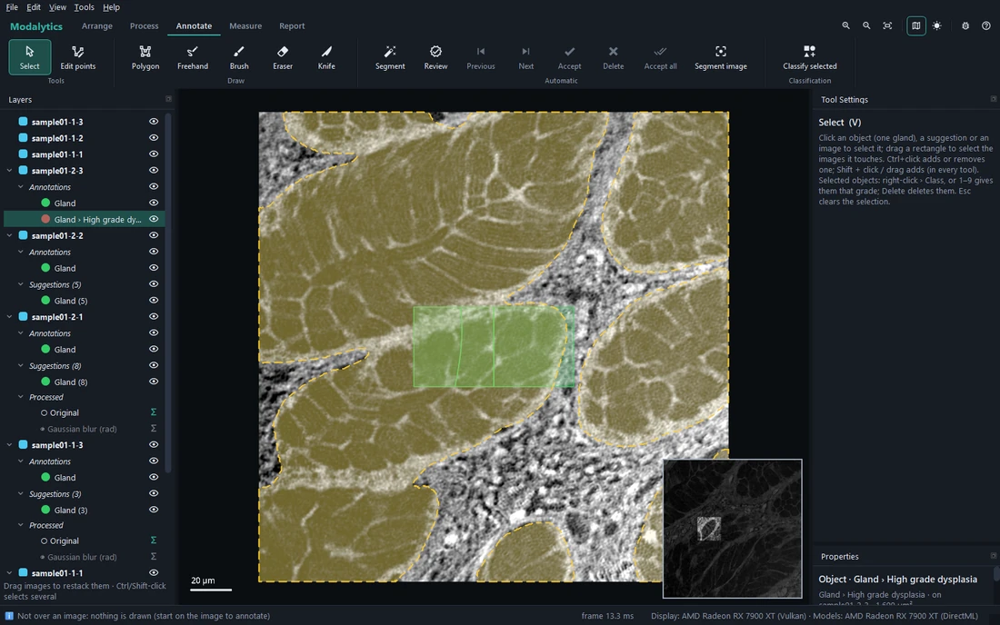
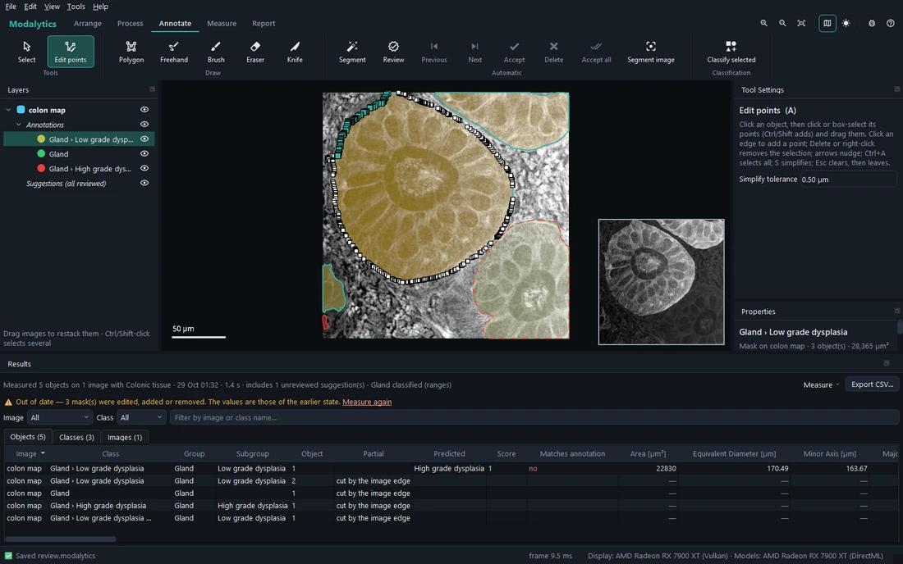
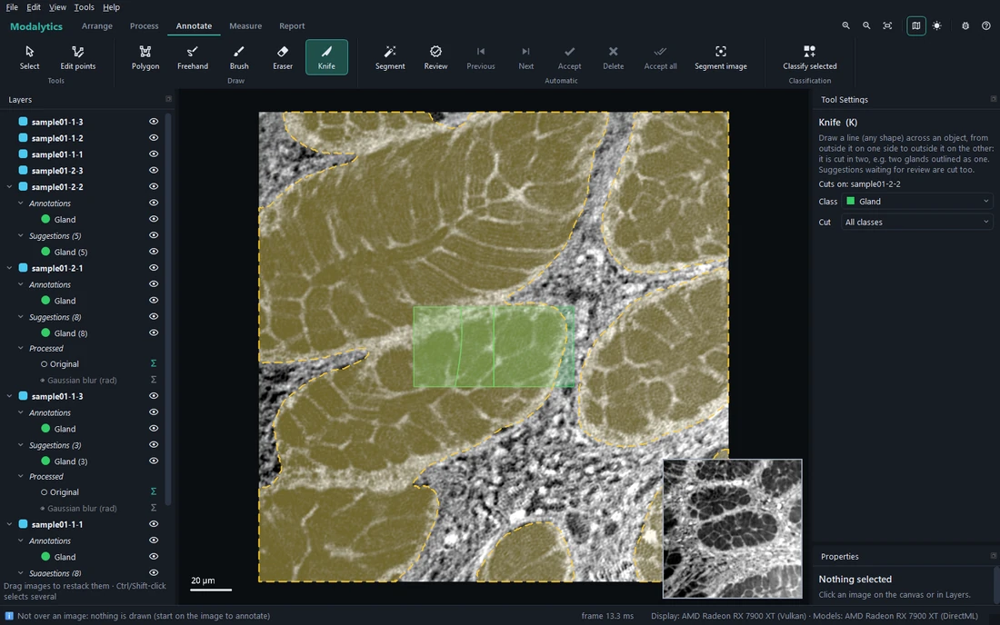
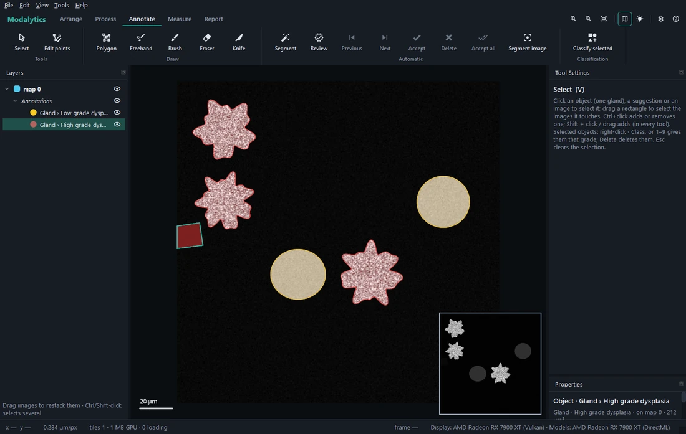
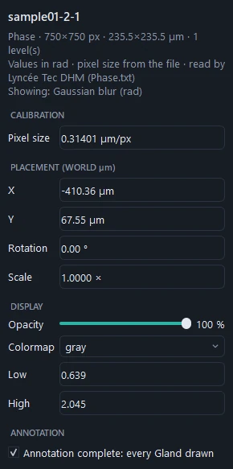

# Annotating

The **Annotate** tab outlines the objects — by hand with the drawing tools, or with a model (next page). Outlines are
**vector polygons in µm** (with holes), exact at every zoom and on every image; each class is one mask per image.

## Classes and the active class

The profile lists the classes, each a **group › subgroup** with its colour — e.g. *Gland › Low grade dysplasia*. The
drawing tools draw the **Class** chosen in their Tool Settings. Choosing only the group (*Gland*) outlines without a
grade: the grade can be given later.

**Overwrite other classes** (on by default): a newly drawn class takes the area over from the image's other classes,
so classes never overlap. Switch it off for nested regions (e.g. nuclei drawn inside cells).

## Selecting

**Select** (<kbd>V</kbd>):

- click an **object** (one gland), a suggestion or an image; drag a rectangle to select the images it touches;
- <kbd>Ctrl</kbd>+click adds or removes one, <kbd>Shift</kbd>+click adds (in every tool);
- with objects selected: **right-click › Class** gives them another class, <kbd>1</kbd>–<kbd>9</kbd> gives each its
  group's n-th grade, <kbd>Delete</kbd> deletes only them (their layer stays), **Properties › Class** too;
- <kbd>Esc</kbd> clears the selection.

**Right-click without moving** (in any tool) opens the settings of what is under the cursor: an image, a mask, an
object.

## Drawing

Which image a drawing goes on: the image under the point where the stroke **starts** — the selected image if it is
there (to draw on a slide under a phase map, select the slide), otherwise the top visible one. Tool Settings says
*Draws on: <image>* as the cursor moves.

| Tool | Key | How |
| --- | --- | --- |
| **Polygon** | <kbd>P</kbd> | Click points; double-click, <kbd>Enter</kbd>, right-click or the first point closes. <kbd>Backspace</kbd> removes the last point, <kbd>Esc</kbd> cancels. |
| **Freehand** | <kbd>L</kbd> | Press, draw the outline, release. |
| **Brush** | <kbd>B</kbd> | Paint. <kbd>[</kbd> <kbd>]</kbd> change the size; with a pen, lighter pressure paints thinner. |
| **Eraser** | <kbd>E</kbd> | Erase from the active class or all classes; erasing inside a shape makes a hole. |

- Hold <kbd>Alt</kbd> while drawing to **subtract** instead of add.
- A shape that only **touches** an object of its class (less than a fifth of it over the object) stays a **separate
  object** — two touching glands stay two. One drawn mostly over an object extends it.
- **Graphics tablets** (Wacom, XP-Pen…) work as the mouse does, with more: every point of a stroke is kept, the pen's
  **pressure** sets the Brush and Eraser width (*Pen pressure sets the size* turns it off), and the pen's **eraser
  end** erases. Keep the driver's *Windows Ink* option on.

## Editing points

**Edit points** (<kbd>A</kbd>) corrects an outline point by point:

- click an object; click or box-select points (<kbd>Ctrl</kbd>/<kbd>Shift</kbd> adds) and drag them together;
- click an edge to add a point; <kbd>Delete</kbd> or right-click removes the selected points;
- arrow keys nudge (<kbd>Shift</kbd> × 10); <kbd>Ctrl</kbd>+<kbd>A</kbd> selects all points; <kbd>S</kbd> simplifies
  the outline;
- <kbd>Esc</kbd> clears the points, then leaves the object.

## Cutting with the knife

**Knife** (<kbd>K</kbd>): draw a line of any shape across an object, from outside it on one side to outside it on
the other — the object is cut in two (e.g. two glands outlined or suggested as one). Suggestions waiting for review
are cut too, keeping their suggested class. A line that ends inside an object cuts nothing. *Cut*: all classes or
only the active one.

## Partial objects

An object whose **shape is incomplete** — cut by the image edge, by the section plane, torn, folded, out of focus —
must not be measured as if it were whole: its area, perimeter or roundness would be wrong.

- An object cut by the image's edge is found **by itself** (*cut by the image edge*): when more of its outline lies
  on the edge than the profile allows (one that only grazes the edge keeps nearly all its shape).
- Mark the others: **right-click › Partial: shape incomplete**, or *Properties › Shape* (one undo step).

Draw partial glands too — segmentation models learn from them (a piece of gland is gland). When measuring, the
parameters that need the whole shape are left empty for them, with the reason; see
[Measuring and results](05-measure-and-results.md).

## Marking an image as complete

**Properties › Annotation complete: every Gland drawn** (for each group) says that everything of that group on the
image is outlined — so whatever is not drawn is surely not a gland. Training uses it: a segmentation model can then
learn from the whole image, not only around the outlines.

