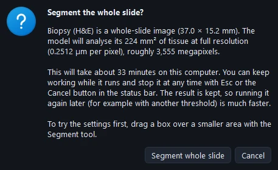
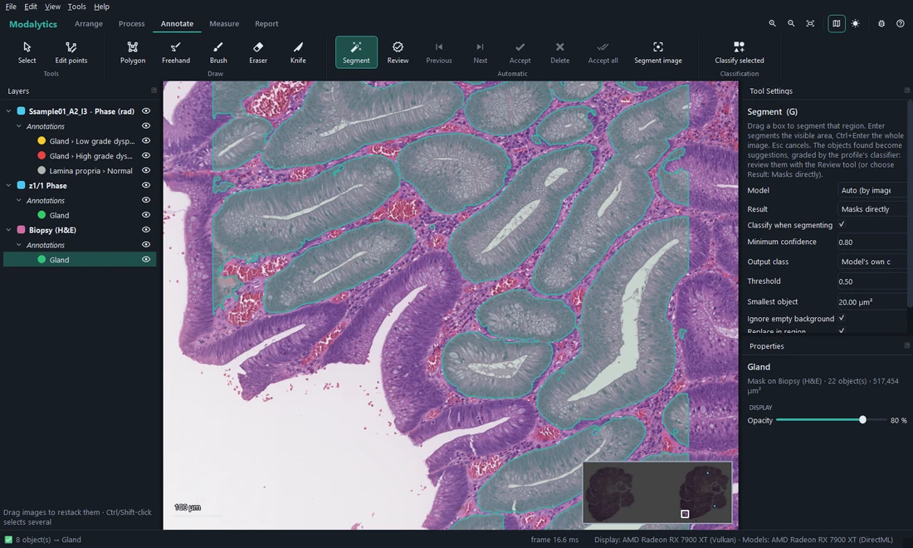
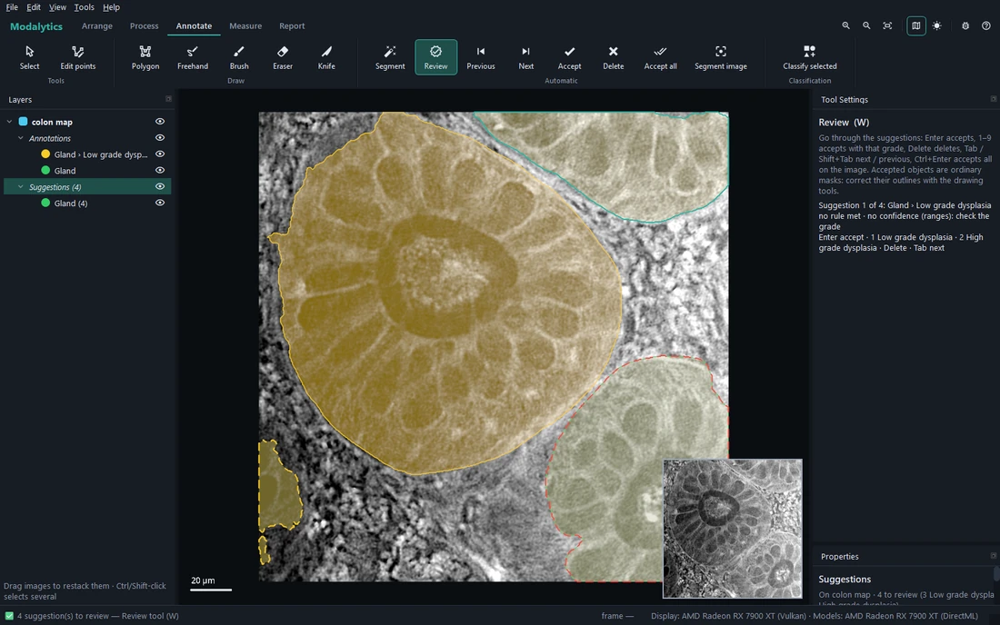
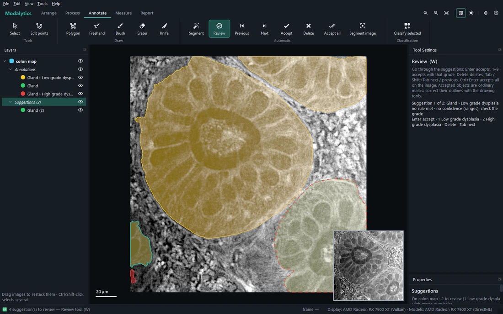

# Segmenting, reviewing and classifying

Segmentation models find the objects; a classifier proposes their grade. Neither changes your annotation by itself:
what they find becomes **suggestions**, which you accept, regrade or delete. Machine grades always pass through your
review — they never become annotations unseen.

## Segmenting

**Segment** (<kbd>G</kbd>): drag a box over the region to segment. The model runs on **every image the box covers**
(the selected ones, if some are under it), each at the resolution it was trained at. <kbd>Enter</kbd> segments the
visible area, <kbd>Ctrl</kbd>+<kbd>Enter</kbd> the whole image; <kbd>Esc</kbd> cancels.

**Segment image** (Annotate › Automatic) segments the whole selected image(s), one after the other, in the background.
When a run would take more than a minute (typically a whole slide), it first says how much tissue will be analysed and
roughly how long it will take, and asks.

The Segment tool's settings:

| Setting | Meaning |
| --- | --- |
| **Model** | *Auto*: the profile's model for the image's type; or any installed model. |
| **Result** | **Suggestions** (to review, the default) or **Masks directly** (straight into the annotation, not classified). |
| **Classify when segmenting** | Each suggestion graded by the profile's classifier (below). |
| **Minimum confidence** | From which confidence the classifier's grade is given (0.80 by default); kept in the profile. |
| **Output class** | The class the objects join (empty: the model's own). |
| **Threshold** | The model's probability above which a pixel is object (0.5). |
| **Smallest object** | Objects smaller than this (µm²) are dropped. |
| **Ignore empty background** | Colour images: drop objects that are mostly bare glass. |
| **Replace in region** | Remove this class inside the region before adding the new result. |
| **Device** | *Auto* (the best graphics card found), a particular one, or the CPU. |

The models run on the graphics card when there is one (any make, through DirectML on Windows). An object you already
drew is not suggested again; if it has no grade, only its grade is suggested.

## Suggestions

Suggestions are drawn **dashed**, in the colour of the class they would join, in each image's **Suggestions** layer —
apart from your annotation. They are saved with the project, so a review can be finished later.

With **Classify when segmenting** on, each suggestion is graded by the profile's classifier for its group:

- classifiers that give a **probability** (logistic regression, random forest, gradient boosting) give a grade only
  from the **minimum confidence** up; below it the object is suggested as the plain group (*Gland*), with its
  confidence and the reason;
- **Ranges** and **Score** (rules of cut-offs and points) give no probability: their grade is always suggested, to be
  checked.

## Reviewing suggestions

**Review** (<kbd>W</kbd>) goes through the suggestions one by one, centred in view, with the suggested grade and the
classifier's reason in Tool Settings:

| Key | Action |
| --- | --- |
| <kbd>Enter</kbd> | Accept, with the suggested grade |
| <kbd>1</kbd>–<kbd>9</kbd> | Accept with that grade (1 = the group's first grade…) |
| <kbd>Delete</kbd> | Delete the suggestion |
| <kbd>Tab</kbd> / <kbd>Shift</kbd>+<kbd>Tab</kbd> | Next / previous |
| <kbd>Ctrl</kbd>+<kbd>Enter</kbd> | Accept all on the image |

The ribbon has the same: **Previous**, **Next**, **Accept**, **Delete**, **Accept all**. A click picks a suggestion;
**Properties** shows the selected one with the same choices.

An accepted suggestion becomes an ordinary mask: correct its outline afterwards with the drawing tools or Edit points.
Where it overlaps objects of its group already drawn, your drawing wins and the overlap is cut away. Two glands
suggested as one are cut apart with the **Knife** before accepting.

Right-click on the *Suggestions* folder (or one of its groups) in Layers: **Accept all** (each with its suggested
grade) or **Delete all** — one undo step each.

> **Note** Measuring, reports and training use only the annotation — reviewed objects. *Measure › Include
> suggestions* measures the unreviewed ones too, as if accepted; their rows are marked "(suggested)".

## Classifying objects you selected

**Classify selected** (Annotate › Classification) grades the selected objects (Select tool: click a gland,
<kbd>Shift</kbd>+click adds more) with the profile's classifier, the same way:

- where a sure grade **differs** from the object's grade, it becomes a suggestion and Review starts on it
  (<kbd>Enter</kbd> accepts the new grade, <kbd>Delete</kbd> keeps yours);
- the others are reported — agreeing, or unsure with their confidence.

## Classifying the whole project

**Measure** applies the profile's classifiers to every object: each gets a **Predicted** grade, its **Score** (the
points, or the conditions met) with the reason as a tooltip, and whether it **matches its annotation**. The
annotated class itself is never changed. See [Measuring and results](05-measure-and-results.md).
