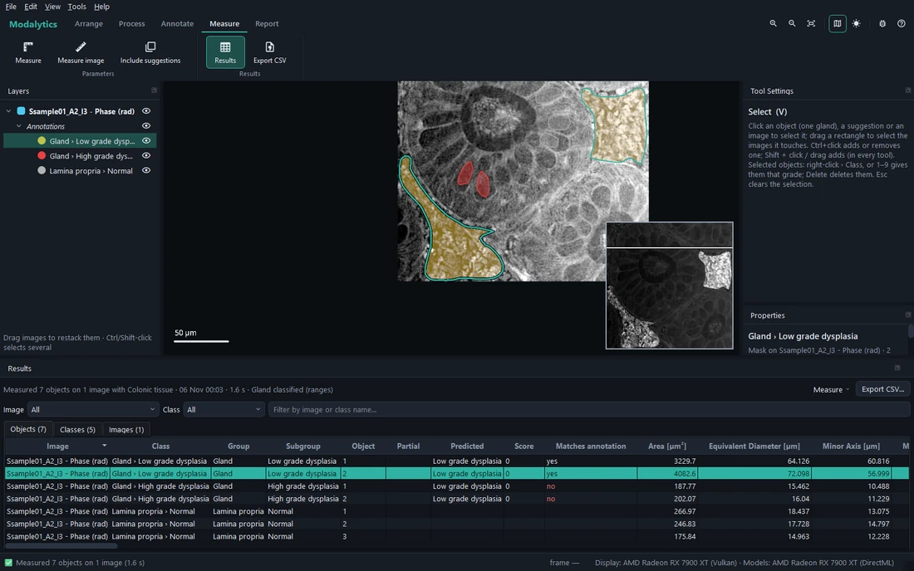
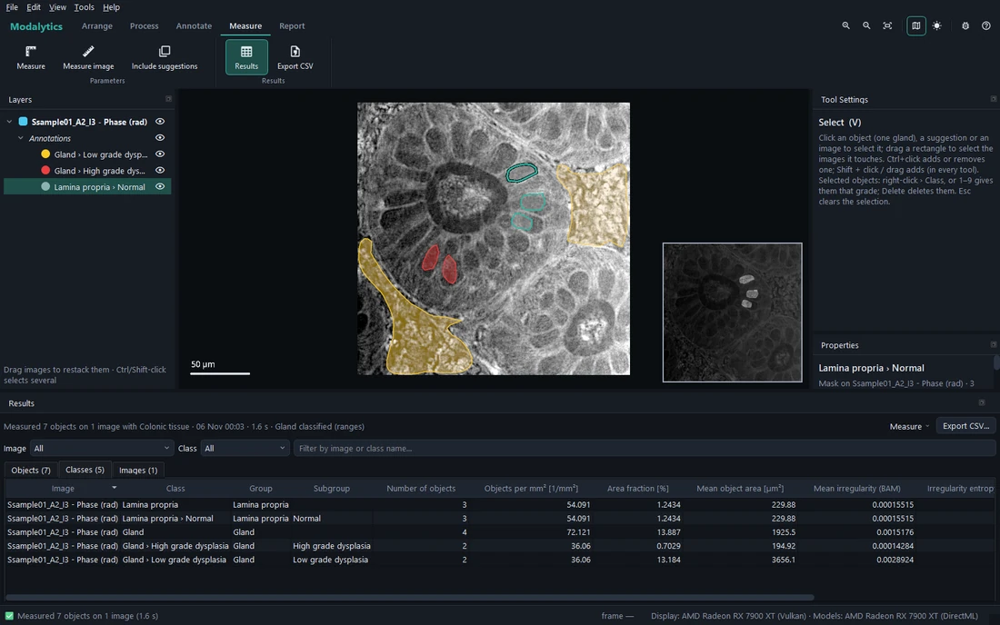
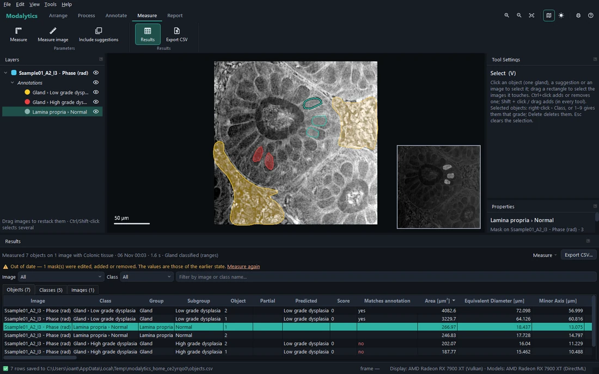
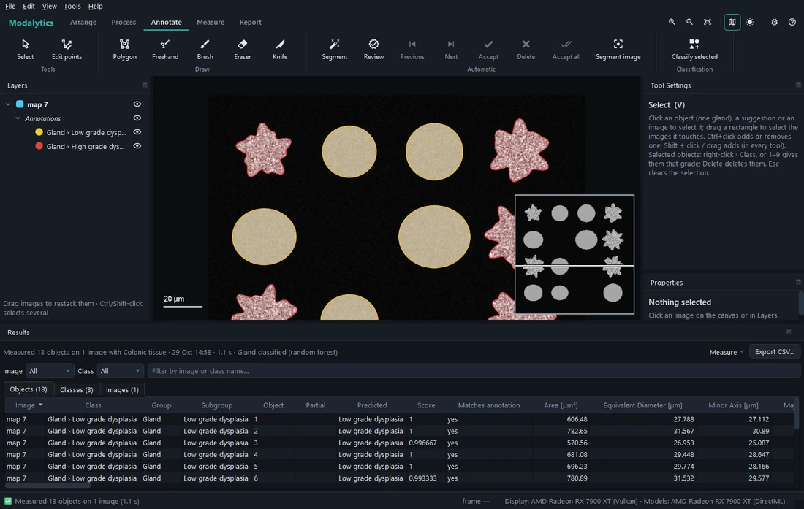

# Measuring and results

## Measure

**Measure** (Measure tab, <kbd>Ctrl</kbd>+<kbd>M</kbd>) measures every image of the project with the parameters its
profile chose, in the background — progress and *Cancel* in the status bar. **Measure image** measures only the
selected image and keeps the others' results. **Include suggestions** also measures the suggestions not yet
reviewed, as if accepted.

When the profile has a newer classifier in your library than the project's copy, Measure first offers to use it.

## The Results panel

Under the canvas, three tables:

- **Objects** — one row per object (each separate outline of a class) with the per-object parameters: area,
  perimeter, shape, intensity, texture… and, when classified, **Predicted**, **Score** and **Matches annotation**.
  Clicking a row selects the object and brings it into view.
- **Classes** — one row per class on each image: the group as a whole (*Gland*: all glands) and each subgroup —
  counts, densities, area fractions, gland-grading summaries.
- **Images** — one row per image, with the whole-image parameters.

- Columns **sort** by value (click the title) and the tables can be **filtered** by image, class or name.
- A column title's **tooltip** gives the parameter's description, formula and references.
- An empty cell (—) says **why** it has no value on hover — e.g. an OD parameter on an image with no OD view, or a
  shape parameter on a partial object.
- **Export CSV…** saves the table shown (spreadsheet programs read its µm² correctly).

Results are **saved with the project** and shown again when it is opened.

## When the results are out of date

When masks are edited, images added or removed, or the profile's parameters changed after measuring, a banner says
the results are **out of date** and why. Measure again to update them.

## Partial objects

A **partial** object (shape incomplete: cut by the image edge, or marked — see
[Annotating](03-annotate.md#partial-objects)) is measured, but:

- the parameters that **need the whole object** — shape, totals over the object (dry mass, integrated OD), what
  follows the outline — are **left empty**, with the reason on hover; pixel statistics and texture measure the
  visible part;
- it is **graded** only by a classifier that reads none of those parameters; otherwise it stays **not graded**, with
  the parameters that stopped it — never guessed from an incomplete shape;
- the report's shape statistics leave it out, and say so.

## Predicted grades

When the profile has a classifier for a group, each of its objects gets:

| Column | Meaning |
| --- | --- |
| **Predicted** | The grade the classifier gives |
| **Score** | Its points or the conditions met (Ranges, Score), or its confidence; the reason as a tooltip |
| **Matches annotation** | Whether it agrees with the object's annotated grade (a *no* is shown in red) |

The annotated class is never changed by measuring. To turn a predicted grade into an annotation, use **Classify
selected** and review it ([Segmenting, reviewing and classifying](04-segment-review-classify.md#classifying-objects-you-selected)).
