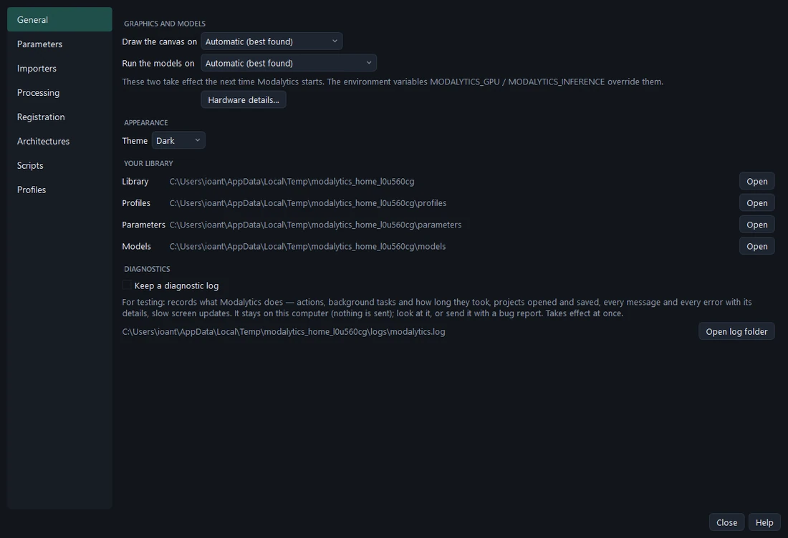

# Settings and hardware

**File › Settings…** (<kbd>Ctrl</kbd>+<kbd>,</kbd>) or **Settings** on the start screen. **General** holds this
computer's preferences; the other pages (Parameters, Importers, Processing, Registration, Architectures, Scripts,
Profiles) are the libraries that prepare an analysis — see *Profiles, parameters and training*. <kbd>F1</kbd> or the
**Help** button opens the help on the page shown.

## Graphics and models

- **Draw the canvas on** — *Automatic (best found)*, or a particular graphics card or API.
- **Run the models on** — *Automatic*, a particular graphics card, or the CPU.
- **Hardware details…** — everything found: graphics cards, the APIs they work through, the devices the models can
  use.

Both take effect the next time Modalytics starts. Modalytics finds the hardware itself at each start — a dedicated
graphics card before an integrated one, before software drawing — so the same installation works on a workstation
with two cards, a laptop, a virtual machine or a remote session. The status bar shows the choice (hover it for
details).

| What | Where it runs | Speed (512 px tile, one gland model) |
| --- | --- | --- |
| Drawing the canvas | Vulkan, Direct3D 12 or OpenGL on the graphics card; software when there is none (slow) | 4–5 ms per frame on a graphics card |
| Segmentation models | the graphics card through DirectML on Windows (NVIDIA, AMD, Intel), CUDA on Linux, else the CPU | ~10–30 ms on a graphics card, ~275 ms on the CPU |

With no usable graphics card everything still works, slowly, and Modalytics says so.

## Appearance

**Theme** — *Dark* or *Light*. The theme button at the right end of the ribbon switches too.

## Your library

Where your profiles, parameters, models, training sets and their runs are kept — on Windows
`%APPDATA%\Modalytics`. **Open** shows each folder. Your library is yours: installing a new version of Modalytics
never overwrites it.

## Diagnostics

**Keep a diagnostic log** (off by default) writes `logs/modalytics.log` in your library: versions, every message and
error with its details, background tasks and how long they took, projects opened and saved, slow screen updates. It
stays on this computer — nothing is sent. Turn it on, do again what went wrong, and send the log with your bug report
(**Report a bug**, at the right end of the ribbon, says where the file is).
