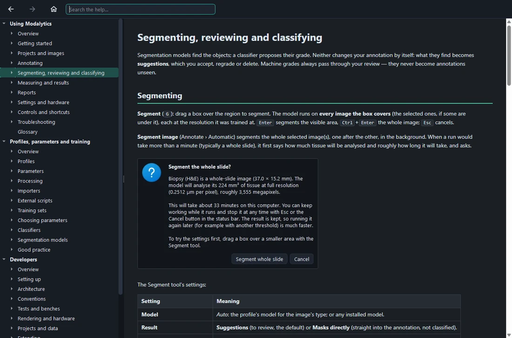

# Using Modalytics

Modalytics puts every image of a sample — whole-slide images, quantitative phase maps, ordinary microscope
pictures — into one **micrometre-true** space, where they can be superposed, outlined, segmented, registered,
measured and classified, and the result written up as a report.

This guide is for everyone who **analyses**: you open or start a project, bring in its images, outline or segment
the objects (glands, cells…), review what the models suggest, measure, and write the report. What is measured and how
objects are graded comes from the project's **profile**, prepared by the people who set up the analysis (their
guide is *Profiles, parameters and training*).

> **Tip** Press <kbd>F1</kbd> anywhere: the help opens on the page for what you are doing — the tool you hold, the
> ribbon tab you are on, the Settings page or Training tab shown.

The help is part of Modalytics and works without internet. **Search** finds the sections holding every word typed
(<kbd>Ctrl</kbd>+<kbd>F</kbd>); <kbd>Alt</kbd>+<kbd>←</kbd> / <kbd>Alt</kbd>+<kbd>→</kbd> go back and forward.

## The pages

1. [Getting started](01-getting-started.md) — the start screen, a first project, the window.
2. [Projects and images](02-projects-and-images.md) — importing, arranging, processing, registering, saving.
3. [Annotating](03-annotate.md) — selecting, drawing, editing outlines, classes and grades.
4. [Segmenting, reviewing and classifying](04-segment-review-classify.md) — models that suggest, you decide.
5. [Measuring and results](05-measure-and-results.md) — the parameters, the Results tables, CSV.
6. [Reports](06-reports.md) — the HTML report and its PDF summary.
7. [Settings and hardware](07-settings-and-hardware.md) — theme, graphics card, your library, the diagnostic log.
8. [Controls and shortcuts](08-controls.md) — every key and mouse gesture on one page.
9. [Troubleshooting](09-troubleshooting.md) — when something does not work as expected.
10. [Glossary](10-glossary.md) — the words Modalytics uses.

## Words used throughout

- A **project** is one sample — a biopsy, a smear, a culture — with all its images, in one `.modalytics` file.
- A **profile** is one kind of analysis (e.g. *Colonic tissue*): which images it takes, its classes, models,
  parameters and classifiers. Each project keeps its own copy.
- An **object** is one separate outline of a class: one gland, one cell.
- A **class** is a group and a subgroup, e.g. *Gland › High grade dysplasia*: the group is what is outlined
  (*Gland*), the subgroup what each object is graded as.
